# Email Confirmations & Notifications Plan

This plan covers how to add transactional and digest emails to **LiveArchive** using **Resend** on Cloudflare Workers while keeping the setup simple, free-tier friendly, and compliant with industry standards (RFC 8058 One-Click Unsubscribe, SPF/DKIM/DMARC, and fail-safe execution).

---

## 1. End-to-End Lifecycle & Flow

```mermaid
sequenceDiagram
    autonumber
    actor Owner as Owner (Charlie)
    actor User as Invitee / Requester
    participant App as LiveArchive Worker (/app & /api)
    participant DB as Supabase (members / access_requests / email_preferences)
    participant Resend as Resend API

    rect rgb(30, 27, 46)
    note right of Owner: Flow A: Owner Adds User to Invite List (#2)
    Owner->>App: Add email to Invite List (Members Panel)
    App->>DB: Record invite & check email_opt_outs
    App->>Resend: Send Email #2 (Invite + How to Log In & Request/Join)
    Resend-->>User: "You're invited to LiveArchive — how to sign in"
    end

    rect rgb(24, 38, 34)
    note right of User: Flow B: User Logs In & Requests Access (#1)
    User->>App: Sign in via Cloudflare Access (Google) -> /app
    User->>App: Click "Request access" (POST /api/access-requests)
    App->>DB: access_request_submit (status = 'pending', requested_at = now())
    note over App,DB: Daily Cron at 16:00 UTC (8:00 AM PT)
    App->>DB: Query pending requests where requested_at > last_digest_at
    App->>Resend: Send Email #1 (Daily Request Digest, if new >= 1)
    Resend-->>Owner: "N new access requests waiting in LiveArchive"
    end

    rect rgb(36, 30, 46)
    note right of Owner: Flow C: Owner Approves Member (#3)
    Owner->>App: Click "Accept" (PUT /api/access-requests/:email -> 'accepted')
    App->>DB: access_request_set ('accepted') + check email_opt_outs
    App->>Resend: Send Email #3 (Approved + Welcome & Next Steps)
    Resend-->>User: "Welcome to LiveArchive — your tracker is ready"
    end
```



### How Invite (#2) vs. Approval (#3) Work Together

In your current codebase ([`src/server/auth/members.ts`](../src/server/auth/members.ts) and [`src/components/MembersPanel.tsx`](../src/components/MembersPanel.tsx)), Cloudflare Access guards `/app` and `/api/*`. To support **Option A** cleanly:

1. **Adding to the Invite List (Email #2):**
   - When you enter an email in the **Members** tab (`POST /api/members`) and click **Invite**, the app sends **Email #2** explaining that they have been added to the invite list, how to sign in at `https://concert.charliechonguyen.com/app` with their Google account, and how to request/activate their tracker.
   - *Two ways we can wire the database state when you click Invite:*
     - **Two-Step (Gate + Request):** `POST /api/members` records the invite (or you add them to Cloudflare Access + click "Send invite" in the app) so when they sign in at `/app`, they see the Sample Mode banner, click **Request access**, and then receive **Email #3** when you click **Accept** in the Requests tab.
     - **Pre-Approved Invite + First-Login Welcome:** `POST /api/members` continues to pre-create their `members` row (`user_id = null`) and sends **Email #2** immediately; then **Email #3** is sent automatically either when you click **Accept** on a pending request (`PUT /api/access-requests/:email`) **or** when a pre-invited member signs in for the first time ([`resolveMember`](../src/server/auth/members.ts#L62-L65) links their `user_id`).

> [!TIP]
> **Pre-Approved Invite + First-Login Welcome** lets you keep one-step inviting for close friends (they don't get stuck waiting after logging in) while still sending them Email #2 on invite and Email #3 ("Welcome & Next Steps") on their first sign-in—and anyone who requests access from the banner gets Email #3 as soon as you click **Accept**. Or, if you strictly want every invited user to click "Request access" and wait for your approval before getting a tracker, we can make `POST /api/members` create an `invited` row that still requires clicking **Accept**.

---

## 2. Industry Standards & Deliverability Checklist

1. **Dedicated Sending Subdomain on Cloudflare (`mail.charliechonguyen.com`)**
   - Send from `LiveArchive <notifications@mail.charliechonguyen.com>` (configured via `EMAIL_FROM` in [`wrangler.jsonc`](../wrangler.jsonc)).
   - Using a subdomain protects your root domain reputation and takes ~2 minutes to verify in Resend (it can auto-configure Cloudflare DNS records for **SPF**, **DKIM**, and **DMARC**).
   - Set `Reply-To` to `CONTACT_EMAIL` / `OWNER_EMAIL` so if a friend replies to an invite or welcome email, it goes to your inbox.
2. **Both Plain-Text and Minimal HTML Bodies**
   - Every email sends both `text` and `html` payloads to Resend. Spam filters penalize HTML-only emails, and plain-text ensures readability on every device.
3. **One-Click Unsubscribe Headers (RFC 8058) + Footer Link**
   - Every outbound email includes:
     - `List-Unsubscribe: <https://concert.charliechonguyen.com/unsubscribe?email=...&sig=...>`
     - `List-Unsubscribe-Post: List-Unsubscribe=One-Click`
   - And a visible footer link: *"Don't want emails from LiveArchive? Unsubscribe in one click."*
4. **Non-Blocking Delivery**
   - Email sending is wrapped so a Resend error or missing `RESEND_API_KEY` never crashes or rolls back a database change. In [`MembersPanel.tsx`](../src/components/MembersPanel.tsx), the API response returns `{ ok: true, emailSent: boolean, emailNote?: string }` so you can see whether the email went out.

---

## 3. Database & State Design

### New Migration: `supabase/migrations/0028_email_notifications.sql`

We only need one small table for opt-outs and sent-email tracking (to guarantee idempotency so nobody is accidentally sent the same invite or welcome email twice):

```sql
-- Tracks who has opted out of emails, plus timestamps of transactional emails
-- sent so re-clicking Accept or Invite does not spam the recipient.
create table if not exists email_preferences (
  email text primary key check (email = lower(email)),
  opted_out boolean not null default false,
  opted_out_at timestamptz,
  invite_sent_at timestamptz,
  welcome_sent_at timestamptz,
  updated_at timestamptz not null default now()
);

alter table email_preferences enable row level security;
-- No anon/authenticated policies: only the server (service_role) reads/writes this table.
```

### Daily Digest Watermark (`app_settings`)
- Stored in `app_settings` under key `'access_requests'` (alongside `paused` and `cap` in [`src/server/auth/requests.ts`](../src/server/auth/requests.ts)):
  - `lastDigestAt?: string` (ISO timestamp of the last digest check/send).
- **Daily Schedule:**
  - In [`worker/index.ts`](../worker/index.ts#L141-L150), alongside `isRetentionTime(now)` (which runs at `03:00 UTC`), add `isDigestTime(now)` at **`16:00 UTC` (8:00 AM PST / 9:00 AM PDT)**.
  - Queries `access_requests` where `status = 'pending'` and `requested_at > coalesce(lastDigestAt, '1970-01-01T00:00:00Z')`.
  - If there is at least 1 new pending request (and `OWNER_EMAIL` has not opted out), sends the digest email to `OWNER_EMAIL` and updates `lastDigestAt = now.toISOString()`.

---

## 4. Email Templates & Copy

All three emails share a clean, quiet tone matching LiveArchive's UI copy ([`src/services/copy.ts`](../src/services/copy.ts)):

### Email #1: Daily Request Digest (to Owner)
- **Subject:** `LiveArchive: N new access request(s)`
- **Content:**
  - Lists each new requester's email address and when they asked.
  - Shows total pending requests vs. cap (e.g., `3 pending of 20 cap`).
  - Direct link: `Review in LiveArchive → https://concert.charliechonguyen.com/app`
  - Unsubscribe footer link.

### Email #2: Added to Invite List (to Invitee)
- **Subject:** `You're invited to LiveArchive`
- **Content:**
  - **What it is:** *"You've been added to the invite list for LiveArchive — a private log to remember every concert and festival you've been to and who you saw there."*
  - **How to sign in and get added:**
    1. Open `https://concert.charliechonguyen.com/app`
    2. Sign in with Google using **`<recipient@email.com>`** (Cloudflare Access will send a one-time code or verify your Google account).
    3. Click **Request access** on the banner at the top of the page (or, if pre-approved, your archive will open right away).
  - **Privacy note:** *"Your events, imports, and notes are yours alone—nobody else, including the site owner, can see your archive."*
  - Unsubscribe footer link.

### Email #3: Approved & Welcome (to Member)
- **Subject:** `Welcome to LiveArchive — your archive is ready`
- **Content:**
  - **Confirmation:** *"Your LiveArchive account (`<recipient@email.com>`) is approved and ready."*
  - **Primary CTA:** `Open your archive → https://concert.charliechonguyen.com/app`
  - **Recommended next steps:**
    1. **Add a show you remember:** Type one line at the top of Home, like `Porter Robinson at the Greek Theatre, Oct 5 2024` or `EDC Las Vegas 2025`.
    2. **Check your ticket emails:** Scan your Gmail right in your browser for past Ticketmaster, AXS, DICE, Eventbrite, and RA orders—your email bodies never leave your browser, and nothing is saved until you tick it.
    3. **Import a list:** Have a spreadsheet or Notion table? Import a CSV from the **Table** tab.
    4. **Turn on Private Notes (optional):** Encrypt your notes and companions in your browser from **Menu → Your account**.
  - Unsubscribe footer link.

---

## 5. Opt-Out Architecture (Public + In-App)

1. **Signed Unsubscribe URLs (`src/server/email/unsubscribe.ts`)**
   - Uses Node/Web Crypto `HMAC-SHA256` with a Worker secret `EMAIL_UNSUBSCRIBE_SECRET` (or falls back to `SUPABASE_JWT_SECRET` if unset) over `unsubscribe:<lowercase-email>`.
   - URL: `https://concert.charliechonguyen.com/unsubscribe?email=<url-encoded-email>&sig=<base64url-hmac>`
2. **Public Unsubscribe Route (`/unsubscribe`)**
   - Added to [`PUBLIC_EXACT_PATHS`](../src/server/site/publicPaths.ts#L8-L25) (and documented in [ARCHITECTURE.md](../ARCHITECTURE.md#L322-L325) so `tests/publicPages.test.ts` passes).
   - Handled in [`src/server/share/door.ts`](../src/server/share/door.ts) before Cloudflare Access:
     - `GET /unsubscribe?email=...&sig=...`: Renders a self-contained, script-free HTML page (matching the share page's strict CSP) confirming their email status with a `<form method="POST">` button to **Unsubscribe** (or **Re-subscribe** if already opted out). *(Note: Making `GET` show a confirmation button or only mutating on `POST` prevents aggressive email link pre-fetchers from accidentally unsubscribing users before they click!)*
     - `POST /unsubscribe?email=...&sig=...`: Sets `opted_out = true` (or `false` when `action=resubscribe` is posted from the page) and returns `200 OK` (satisfying RFC 8058 `List-Unsubscribe-Post` one-click clients like Gmail/Apple Mail as well as the HTML form).
3. **In-App Toggle (`AccountPanel.tsx` & `/api/me/email-prefs`)**
   - `GET /api/me/email-prefs` and `PUT /api/me/email-prefs` (`{ optedOut: boolean }`) allow any signed-in member (or the owner) to toggle email notifications inside **Menu → Your account** ([`src/components/AccountPanel.tsx`](../src/components/AccountPanel.tsx)).

---

## 6. Files to Create / Update

| File | Change |
| --- | --- |
| `supabase/migrations/0028_email_notifications.sql` | Create `email_preferences` table with RLS enabled (service role only). |
| `src/server/email/sender.ts` | `EmailSender` interface, `resendSender` (`fetch` to `https://api.resend.com/emails`), and no-op fallback when `RESEND_API_KEY` is unset. |
| `src/server/email/templates.ts` | Subject, plain-text, and HTML generators for the 3 emails (Digest, Invite, Approval Welcome). |
| `src/server/email/unsubscribe.ts` | HMAC signing/verification (`signUnsubscribe`, `verifyUnsubscribe`) and plain-HTML `/unsubscribe` page renderer. |
| `src/server/email/digest.ts` | `isDigestTime(now)` (16:00 UTC) and `runRequestDigest(...)` checking new pending requests since `lastDigestAt`. |
| [`src/server/site/publicPaths.ts`](../src/server/site/publicPaths.ts) | Add `'/unsubscribe'` to `PUBLIC_EXACT_PATHS` and `Disallow: /unsubscribe` in `robotsTxt`. |
| [`src/server/share/door.ts`](../src/server/share/door.ts) | Handle `GET` and `POST /unsubscribe` with strict security headers before Access check. |
| [`src/server/auth/routes.ts`](../src/server/auth/routes.ts) & [`src/server/auth/requestRoutes.ts`](../src/server/auth/requestRoutes.ts) | Send Email #2 on invite (`POST /api/members`), Email #3 on approval (`PUT /api/access-requests/:email` $\rightarrow$ `'accepted'`), and add `/api/me/email-prefs`. |
| [`src/components/MembersPanel.tsx`](../src/components/MembersPanel.tsx) & [`src/components/AccountPanel.tsx`](../src/components/AccountPanel.tsx) | Optional "Send invite email" checkbox in Members panel; "Email notifications" opt-out toggle in Account panel. |
| [`worker/index.ts`](../worker/index.ts) & [`wrangler.jsonc`](../wrangler.jsonc) | Add `/unsubscribe` to `run_worker_first`, wire daily digest in `scheduled`, document `RESEND_API_KEY`, `EMAIL_FROM`, and `EMAIL_UNSUBSCRIBE_SECRET`. |
| [`REQUIREMENTS.md`](../REQUIREMENTS.md), [`ARCHITECTURE.md`](../ARCHITECTURE.md), [`public/privacy.html`](../public/privacy.html) | Document the email notifications, `/unsubscribe` public path, and Resend disclosure in Privacy. |
| `tests/emailNotifications.test.ts` | Unit and route tests for digest batching, invite/welcome triggers, idempotency, opt-out suppression, and HMAC unsubscribe verification. |
