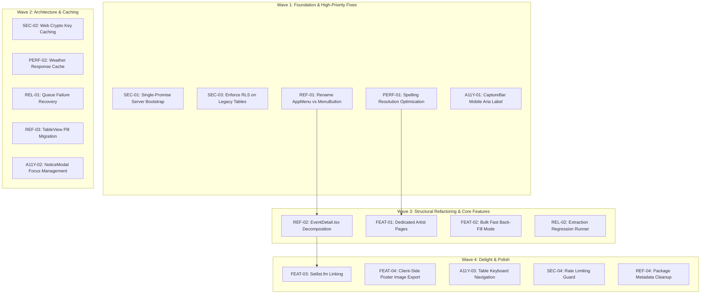

# LiveArchive Engineering Ticket Bank

> **Role & Purpose**: Authored by the Principal Engineering Lead. This document represents a comprehensive architectural audit, gap analysis, and ticket repository for future multi-threaded development on LiveArchive.  
> **Status**: Planning & Backlog. Ready for independent assignment across parallel engineering agents or contributors.
> **Guiding Documents**: [REQUIREMENTS.md](../REQUIREMENTS.md), [ARCHITECTURE.md](../ARCHITECTURE.md), and [AGENTS.md](../AGENTS.md).
> **Revised 2026-11-02**: SEC-01, PERF-01, PERF-02, REL-01, A11Y-02, A11Y-03 and FEAT-03 were rewritten after a code-checked peer review ([tier2-ticket-review.md](archive/tier2-ticket-review.md)). FEAT-03 is blocked.
> **Trimmed 2026-11-24**: the eleven tickets that `docs/tier3-specs.md` specifies again (SEC-03, SEC-04, PERF-03, PERF-04, PERF-05, REL-02, REF-02, TECH-01 to TECH-03, LINEUP-05) now point there instead of repeating it.
> **Checked 2026-11-04**: six closed tickets from the first pass plus three from the second pass (REL-01, LINEUP-02, LINEUP-03) moved to [docs/archive/engineering-ticket-bank-closed.md](archive/engineering-ticket-bank-closed.md). Ten open tickets carry a verdict line from the 2026-11-04 code audit.

---

## Executive Summary & System Health

LiveArchive is an exceptionally well-architected, invariant-driven personal concert tracking application. It demonstrates strict discipline around data provenance (verbatim citations, no synthetic facts, separation of canonical editions from personal logs), offline capabilities, and cloud runtime cost constraints (free-tier Cloudflare Workers and Supabase).

However, as the system has expanded across 28 Supabase migrations and added multi-user capabilities, Cloudflare Access gating, email notifications, client-side encryption vaults, and timeline analytics, several architectural gaps, security hardening opportunities, component scaling bottlenecks, and UX polishes have emerged.

This backlog organizes **23 granular, self-contained engineering tickets** across 5 distinct tracks designed for concurrent multi-threaded execution.

---

## Ticket Overview Matrix

| ID | Track | Title | Priority | Complexity | Target Area |
|---|---|---|---|---|---|
| **SEC-03** | Security | Enforce RLS on Legacy & Base Tables (`0002_source_first_lineups.sql`) | P1 | Medium | `supabase/migrations/` |
| **SEC-04** | Security | Add IP & Member Rate Limiting on Mutation Endpoints | P2 | Medium | `src/server/auth/`, `worker/` |
| **PERF-01** | Optimization | Scoped, Paged `listSeenArtistNames` for Spelling Resolution in `stageMerge` | P1 | Small | `src/server/lineup/pipeline.ts`, `store/*` |
| **PERF-02** | Optimization | Per-Host Cache Policy for the Open-Meteo Archive (deferrable) | P3 | Small | `src/server/lineup/responseCache.ts` |
| **PERF-03** | Optimization | Worker Subrequest Budgeting Guard in Stage 1 Research | P2 | Medium | `src/server/events/details.ts` |
| **REL-02** | Reliability | Extraction Prompt & Model Regression Test Runner | P2 | Medium | `scripts/`, `src/server/lineup/` |
| **REF-02** | Refactoring | Decompose Monolithic `EventDetail.tsx` (1,552 LOC) | P2 | Large | `src/components/EventDetail.tsx` |
| **REF-03** | Refactoring | Migrate Inline Status Badges to Shared `Pill` Component | P2 | Small | `src/components/TableView.tsx` |
| **A11Y-01** | Accessibility | Fix Mobile Unlabelled Button in `CaptureBar` | P1 | Trivial | `src/components/CaptureBar.tsx` |
| **A11Y-02** | Accessibility | Standardize `NoticeModal` on Shared `Dialog` Focus Management | P2 | Small | `src/components/NoticeModal.tsx` |
| **A11Y-03** | Accessibility | Arrow-Key Row Navigation & Fewer Tab Stops in Table View | P2 | Medium | `src/components/TableView.tsx` |
| **FEAT-01** | Feature | Dedicated Artist Profile & Lifetime History View | P1 | Large | `src/components/`, `src/services/` |
| **FEAT-02** | Feature | Bulk Fast Back-Fill Mode (Multi-Line Batch Capture) | P2 | Medium | `src/components/`, `src/server/` |
| **FEAT-03** | Feature | Single-Artist Performance Setlist Linking (setlist.fm) — **blocked** | P2 | Medium | `src/server/events/`, `src/components/` |
| **FEAT-04** | Feature | Client-Side Shareable Poster & Year-in-Review Image Export | P2 | Medium | `src/components/`, `src/services/` |
| **LINEUP-04** | Lineup | Tighten Setlist.fm Venue Matching Against Concurrent Shows | P2 | Small | `src/server/lineup/adapters/setlistfm.ts` |
| **LINEUP-05** | Lineup | Canonical Edition Re-Sync / Freshness Protocol — **blocked** | P2 | Large | `src/server/lineup/` |
| **PERF-04** | Optimization | Clashfinder `all.json` Worker Caching & Memory Guard | P2 | Small | `src/server/lineup/adapters/clashfinder.ts` |
| **PERF-05** | Optimization | Client Bundle Code-Splitting for Heavy Sub-Views | P2 | Medium | `src/App.tsx`, `vite.config.ts` |
| **TECH-01** | Reliability | Eliminate Catastrophic Backtracking in `htmlToText` | P2 | Medium | `src/server/lineup/text.ts` |
| **TECH-02** | Tech Debt | Strict Typing for Source Adapters (Eliminate `any`) | P3 | Small | `src/server/lineup/adapters/` |
| **TECH-03** | Reliability | Subrequest Budget Guard for Worker Pipeline Runs | P2 | Medium | `src/server/lineup/pipeline.ts` |

---

## Track 1: Security & Defense-in-Depth

### [SEC-03] Enforce RLS on Legacy & Base Tables (`0002_source_first_lineups.sql`)

The build spec for this ticket is [tier3-specs.md](tier3-specs.md#sec-03-reconcile-row-level-security-with-the-live-database-parallel-lane), checked against the code on 2026-11-03. It replaced the text that was here, so this ticket is described once.

### [SEC-04] Add IP & Member Rate Limiting on Mutation Endpoints

The build spec for this ticket is [tier3-specs.md](tier3-specs.md#sec-04-rate-limits-on-public-and-research-endpoints), checked against the code on 2026-11-03. It replaced the text that was here, so this ticket is described once.

## Track 2: Performance, Scalability & Reliability

### [PERF-01] Scoped, Paged `listSeenArtistNames` for Spelling Resolution in `stageMerge`
- **Classification**: Performance Optimization (revised after [tier2-ticket-review.md](archive/tier2-ticket-review.md))
- **Priority**: P1 (High)
- **Files**: [`src/server/lineup/pipeline.ts`](../src/server/lineup/pipeline.ts), [`src/server/lineup/store/types.ts`](../src/server/lineup/store/types.ts), [`src/server/lineup/store/supabaseStore.ts`](../src/server/lineup/store/supabaseStore.ts), [`src/server/lineup/store/fileStore.ts`](../src/server/lineup/store/fileStore.ts)
- **Problem**:
  In `stageMerge` (line 369 of `pipeline.ts`):
  ```ts
  spellings: yourSpellings((await (job.userId && deps.store.forUser ? deps.store.forUser({ userId: job.userId, role: 'member' }) : deps.store).listEvents()).flatMap((e) => e.seen.map((a) => a.name)))
  ```
  `listEvents()` parses the member's whole event history (sources, details, weather, candidates) only to read `seen[].name`. It's one subrequest, but on Workers Free (10 ms CPU) the JSON parsing is the real cost. `listEvents` also doesn't page, so beyond PostgREST's default 1,000-row cap the list is cut short without any error.
- **Implementation Strategy**:
  1. Add `listSeenArtistNames(): Promise<string[]>` to `LineupStore` as a **required** method, so the compiler makes every store implement it.
  2. `SupabaseLineupStore`: `this.mine(this.own('logged_events').select('seen').is('deleted_at', null))`, paged with `.range(from, from + 999)` until a short page. Flatten to `seen[].name`. It must go through `mine()`/`own()` so `user_id` and RLS apply.
  3. `FileLineupStore`: flatten `seen[].name` over events that aren't deleted.
  4. **`scopedFileStore` overrides (required):** add `listSeenArtistNames: async () => (await keep('event', await base.listEvents())).flatMap(...)`. The scoped store is a `Proxy` that falls through to the base store for any method it doesn't override, so without this the method returns **every member's** names.
  5. `stageMerge` calls `scopedStore.listSeenArtistNames()`. Read only `seen[].name`, as today; don't add `b2b` names.
- **Invariants**: Only the names of the member who started the lookup; events in the trash are left out; spelling output is identical to today's.
- **Test Plan**:
  - Two members on the file store and on a mocked Supabase client → each scoped call returns only that member's names.
  - Deleted events are left out.
  - More than 1,000 rows on Supabase → the complete set comes back (paging works).
  - `stageMerge` candidate is unchanged on an existing `pipeline.test.ts` fixture.
- **Follow-up**: `listEvents` has the same 1,000-row gap (22 call sites). File a separate ticket.

---

### [PERF-02] Per-Host Cache Policy for the Open-Meteo Archive
- **Classification**: Performance / Caching (revised after [tier2-ticket-review.md](archive/tier2-ticket-review.md); low value, can be deferred)
- **Priority**: P3 (Low)
- **Files**: [`src/server/lineup/responseCache.ts`](../src/server/lineup/responseCache.ts), [`src/server/lineup/service.ts`](../src/server/lineup/service.ts), [`ARCHITECTURE.md`](../ARCHITECTURE.md)
- **Problem**:
  `POST /api/events/:id/weather` always calls Open-Meteo. In practice weather is asked for once per event and stored on the event with its `sourceUrl`, so a repeat request means a refresh or a changed city. The hit rate will be low. Open-Meteo archive data is also **not** final: preliminary ERA5T values are replaced by final ERA5 values about 2–3 months later.
  The existing `cachingFetcher` can't take a second host as-is: it hard-codes `sourceType: 'ticketmaster'` and one global 24 h TTL, and it stores any status-200 body, including an archive answer that is all nulls.
- **Implementation Strategy**:
  1. Replace `CACHEABLE_HOSTS` with a per-host policy map: `{ sourceType, ttlMs, accept?(body): boolean }`. Ticketmaster keeps `{ 'ticketmaster', 24h }`.
  2. Add `'archive-api.open-meteo.com': { sourceType: 'open-meteo', ttlMs: 30 days, accept: daily.time non-empty and at least one non-null value }`.
  3. Keep the key as `cacheKey(url)`. It covers every parameter (`daily=`, `timezone`) and avoids float formatting. **Don't** add a hand-built `weather:${lat}:${lon}:...` key.
  4. **Never** cache the geocoder (`geocoding-api.open-meteo.com`). The "exactly one place" check has to run on live results.
  5. Update the comment in `responseCache.ts` on which hosts' terms allow caching, and update ARCHITECTURE.md. Caching stays behind `SOURCE_CACHE=on`.
- **Invariants**: Weather is looked up only when asked, only for a city that geocodes to exactly one place, and stored with its URL; a cache hit returns the same `sourceUrl`; Brave is still never cached.
- **Test Plan**:
  - A second identical archive request → 0 outbound calls, same `WeatherResult` including `sourceUrl`.
  - An all-null archive body is not stored.
  - Geocoder URLs always go to the network.
  - Ticketmaster entries keep a 24 h TTL with `sourceType: 'ticketmaster'`; Open-Meteo entries get 30 days with `sourceType: 'open-meteo'`.

---

### [PERF-03] Worker Subrequest Budgeting Guard in Stage 1 Research

The build spec for this ticket is [tier3-specs.md](tier3-specs.md#perf-03-stage-1-research-budget), checked against the code on 2026-11-03. It replaced the text that was here, so this ticket is described once.

### [REL-02] Extraction Prompt & Model Regression Test Runner

The build spec for this ticket (REL-02A and REL-02B) is [tier3-specs.md](tier3-specs.md#rel-02a-golden-fixtures-for-html-to-text), checked against the code on 2026-11-03. It replaced the text that was here, so this ticket is described once.

## Track 3: Code Architecture & Modular Refactoring

### [REF-02] Decompose Monolithic `EventDetail.tsx` (1,552 LOC)

The build spec for this ticket is [tier3-specs.md](tier3-specs.md#ref-02-split-the-event-detail-view), checked against the code on 2026-11-03. It replaced the text that was here, so this ticket is described once.

### [REF-03] Migrate Inline Status Badges to Shared `Pill` Component
- **Audit 2026-11-04**: OPEN. TableView.tsx uses Pill, but KindBadge (around line 170) keeps its own span; Pill has no matching tone.
- **Classification**: Refactor / Design System
- **Priority**: P2 (Medium)
- **Files**: [`src/components/TableView.tsx`](../src/components/TableView.tsx), [`src/components/ui/Pill.tsx`](../src/components/ui/Pill.tsx)
- **Problem**:
  `TableView.tsx` contains multiple inline `<span className="inline-flex items-center gap-1 rounded-full border px-2 py-0.5 ...">` implementations for attendance status, kind (Concert/Festival), and series tags. AGENTS.md explicitly mandates: *"The design-system approach is wanted: when you touch a component that has its own inline copy of one of these patterns... move it onto the shared component in the same change."*
- **Implementation Strategy**:
  1. Inspect `src/components/ui/Pill.tsx`.
  2. Replace inline badge spans in `TableView.tsx` with `<Pill tone="neutral"|"accent"|"good"|"warn"|"info"|"highlight">`.
  3. Ensure series chips, attendance tags (Upcoming, Missed), and type chips render through `Pill`.
- **Invariants**: Good and warn states must always carry text (never rely on color alone).
- **Test Plan**: Visual inspection across light and dark themes; `npm run lint`.

---

## Track 4: Accessibility (a11y) & UX Polish

### [A11Y-01] Fix Mobile Unlabelled Button in `CaptureBar`
- **Classification**: Accessibility (a11y)
- **Priority**: P1 (High)
- **Files**: [`src/components/CaptureBar.tsx`](../src/components/CaptureBar.tsx)
- **Problem**:
  In `CaptureBar.tsx`:
  ```tsx
  <button type="submit" disabled={!text.trim() || saving} className="...">
    {saving ? <Loader2 className="h-4 w-4 animate-spin" /> : <Plus className="h-4 w-4" />}
    <span className="hidden sm:inline">Add</span>
  </button>
  ```
  On mobile screens (`< 640px`), `<span className="hidden sm:inline">Add</span>` is hidden with `display: none`. The button lacks an `aria-label`, so screen reader users hear only "button" or an unlabelled SVG control.
- **Implementation Strategy**:
  1. Add `aria-label="Add event"` to the button.
  2. Add `aria-hidden="true"` to `<Plus>` and `<Loader2>` icons.
  3. Add `aria-live="polite"` to error and parsing preview regions.
- **Invariants**: No visual disruption to desktop layout.
- **Test Plan**: Screen reader audit or axe-core testing on mobile viewport.

---

### [A11Y-02] Standardize `NoticeModal` on Shared `Dialog` Focus Management
- **Classification**: Accessibility (a11y)
- **Priority**: P2 (Medium)
- **Files**: [`src/components/NoticeModal.tsx`](../src/components/NoticeModal.tsx), [`src/components/ui/Dialog.tsx`](../src/components/ui/Dialog.tsx)
- **Problem**:
  `NoticeModal.tsx` currently renders an ad-hoc backdrop and container (`<div className="fixed inset-0 z-[100] ...">`) without focus trapping, initial focus placement, or background scroll locking. In contrast, `src/components/ui/Dialog.tsx` implements strict focus containment, Tab cycling, Escape handling, and scroll locking.
- **Implementation Strategy**:
  1. Refactor `NoticeModal` to use `Dialog` with `placement="center"`.
  2. Add `dismissible?: boolean` to `Dialog` (default `true`), typed as a discriminated union so `dismissible: true` requires `onClose`. When it's `false`, Escape is ignored (`preventDefault`) and a backdrop `onMouseDown` does nothing.
  3. **Required:** make the app tree `inert` while the notice is open (`App.tsx` renders it alongside the app). Otherwise a dialog opened underneath, for example by a deep link, goes on top of `openDialogs` and takes Escape and Tab.
  4. **Required:** keep the notice above everything else. It uses `z-[100]` and `Dialog` uses `z-50`, so add a layer or z-index option. Pass a `panelClassName` that keeps `max-h-[90vh] overflow-y-auto`, so the accept button stays reachable on mobile.
  5. **Required:** while the request runs, use `aria-disabled` plus a guard instead of `disabled`, so focus doesn't fall to `<body>`. Give the error `role="alert"`.
- **Invariants**: Notice modal cannot be dismissed by clicking outside or pressing Escape (acceptance required). Existing dismissible dialogs behave exactly as before.
- **Test Plan**: Tab stays inside the modal; Escape and backdrop clicks don't close it; body scroll is locked and restored; focus stays inside after a failed accept; regression test that existing dialogs still close on Escape.

---

### [A11Y-03] Arrow-Key Row Navigation & Fewer Tab Stops in Table View
- **Audit 2026-11-04**: OPEN. nextRowId and arrow keys exist; rows still have tabIndex 0 each, no roving tabindex, no scrollIntoView.
- **Classification**: Accessibility & Power UX (revised after [tier2-ticket-review.md](archive/tier2-ticket-review.md))
- **Priority**: P2 (Medium)
- **Files**: [`src/components/TableView.tsx`](../src/components/TableView.tsx)
- **Problem**:
  Desktop rows already have `tabIndex={0}` and open on Enter (`TableView.tsx` ~622). What's missing: every row is its own tab stop, inner controls (such as the series button in `DetailsCell`) add more, and there's no arrow-key movement. With 100+ events, the table costs hundreds of Tab presses to get past.
- **Implementation Strategy**:
  1. Write a pure `nextRowId(rowIds, currentId, key)` helper (ArrowUp, ArrowDown, Home, End; clamps at both ends) so it can be unit-tested.
  2. Track the active row by **`event.id`**, not by index. When it's filtered out, fall back to the nearest remaining row, so some row always has `tabIndex=0`.
  3. Roving tabindex: the active row gets `tabIndex=0` and the others `-1`. Inner controls in rows that aren't active get `tabIndex=-1`.
  4. One `onKeyDown` on `<tbody>`, acting only when `e.target` is a row, so keys on inner buttons and in the filter or capture inputs pass through. Never listen on `document`. Call `preventDefault` on handled keys so the `overflow-auto` container doesn't scroll as well.
  5. Move by index into `rows`, never through DOM siblings, so today-indicator rows are skipped.
  6. Give rows `scroll-margin-top` (sticky `thead`) and call `scrollIntoView({ block: 'nearest' })`.
  7. Don't add `role="grid"`; keep native table semantics. The mobile `<ul>` (`md:hidden`) is unchanged.
- **Invariants**: Enter opens the row (unchanged); typing in the search input never moves row focus.
- **Test Plan**: `nextRowId` clamps and skips nothing; exactly one row has `tabIndex=0` at any time; after re-sorting, focus stays on the same event; Enter on an inner button doesn't open the row; key presses in the search input are ignored.

---

## Track 5: Strategic Feature Enhancements (Delight Roadmap)

### [FEAT-01] Dedicated Artist Profile & Lifetime History View
- **Classification**: Feature (Roadmap Delight #1)
- **Priority**: P1 (High)
- **Files**: `src/components/artist-profile/*` (planned, not yet created), [`src/components/ArtistsView.tsx`](../src/components/ArtistsView.tsx), [`src/services/artists.ts`](../src/services/artists.ts)
- **Spec Reference**: REQUIREMENTS.md Section 13 #1: *"Artist pages: every time you saw someone, with the venues and who you were with."*
- **Problem**:
  Currently, `ArtistsView.tsx` shows an aggregate list with expandable 3-event previews. There is no comprehensive artist profile that presents a user's full journey with an artist: first show, most recent show, all venues visited, companion breakdown, set types (DJ vs Live vs B2B), and personal ratings.
- **Implementation Strategy**:
  1. Add dedicated view state: `?view=artist&name=<artistKey>` in navigation service.
  2. Create `ArtistProfileView.tsx`:
     - Lifetime stats: Total times seen, solo vs support vs headliner, first seen date/venue, longest gap between shows.
     - Who you were with: Companions ranked by frequency with this artist.
     - Chronological timeline of every performance seen.
     - Genre and MusicBrainz metadata tags.
  3. Support one-tap navigation from Table view, Event detail chips, and Stats into this artist page.
- **Invariants**: Missing fields stay missing; names normalized via `normalizeName`.
- **Test Plan**: Verify artist profile accurately calculates lifetime stats across concerts and festivals.

---

### [FEAT-02] Bulk Fast Back-Fill Mode (Multi-Line Batch Capture)
- **Classification**: Feature (Roadmap Delight #2)
- **Priority**: P2 (Medium)
- **Files**: `src/components/BackfillModal.tsx` (planned, not yet created), [`src/server/events/routes.ts`](../src/server/events/routes.ts)
- **Spec Reference**: REQUIREMENTS.md Section 13 #2: *"Back-fill mode: type one line per event in a box (a whole year at once) and stage 1 handles each."*
- **Problem**:
  Adding past years of concert history one by one via `CaptureBar` requires repetitive typing and clicking. Users migrating from notes or personal logs want to paste 10-50 lines at once.
- **Implementation Strategy**:
  1. Add `POST /api/events/batch` accepting `{ lines: string[] }` (max 50 per request).
  2. Parse each line deterministically in code via `parseEventInput` (`src/server/events/parse.ts`).
  3. Store all created events in single batch `putEvents`.
  4. Create `BackfillModal.tsx` in UI with a multiline textarea, live preview table showing parsed dates/venues, and single "Save all" action.
- **Invariants**: Capture remains single-line format; no model call in parsing; Stage 2 lineup lookup is never triggered automatically.
- **Test Plan**: Unit test parsing 20 lines; integration test asserting batch creation in DB.

---

### [FEAT-03] Single-Artist Performance Setlist Linking (setlist.fm)
- **Classification**: Feature (Roadmap Delight #3)
- **Priority**: P2 (Medium)
- **Files**: [`src/server/events/details.ts`](../src/server/events/details.ts), [`src/components/EventDetail.tsx`](../src/components/EventDetail.tsx)
- **Spec Reference**: REQUIREMENTS.md Section 13 #3: *"Setlists: for a seen act at a single-artist show, link the setlist.fm setlist for that night."*
- **Status**: **BLOCKED** (see [tier2-ticket-review.md](archive/tier2-ticket-review.md)). Unblock by: (a) updating REQUIREMENTS.md and ARCHITECTURE.md to move this from an idea to a requirement; (b) removing the made-up fallback URLs, `s.url ?? 'https://www.setlist.fm'` in `details.ts` and `s.url ?? doc.url` (a search URL) in `adapters/setlistfm.ts`, so neither can ever be stored as a setlist link.
- **Required constraints once unblocked**:
  - Accept only an API-provided URL matching `^https://www\.setlist\.fm/setlist/[^/]+/\d{4}/.+\.html$`; otherwise store nothing.
  - Attach a link only when the setlist's `eventDate` equals the event's stored `startDate` exactly (the finder's ±1 day window is not enough), the venue matches, there's exactly one setlist for that artist that day, the artist's normalized name equals one seen act, and the event's scale is Concert (`scale.ts`). Only from the candidate that was applied or picked.
  - Store it separately from `SeenAct` (for example `event.setlists: Array<{ actKey, url, eventDate, venue, checkedAt }>`), joined by `key` when rendering, so renaming or removing an act can't leave a stale or misattached link.
  - Decide explicitly whether the link appears on public share pages.
  - Tests: missing `s.url` → no link; ±1 day match → no link; two same-day setlists → no link; renamed act → link dropped; never set from a Gemini-read source.
- **Problem**:
  When setlist.fm matches an event in Stage 1 research, the setlist URL is used internally for date/venue confirmation but is not stored or surfaced as a persistent setlist citation link on the seen artist row.
- **Implementation Strategy**:
  1. When setlist.fm finder confirms an event, capture the `setlist.fm/setlist/...` URL in candidate metadata.
  2. Store setlist URL under `LoggedEvent.sources` or `SeenAct.setlistUrl`.
  3. On the Event Detail view, render a discrete external link "Setlist on setlist.fm" next to the seen artist.
- **Invariants**: Only link if confirmed for that exact date and artist; never fabricate setlists.
- **Test Plan**: Test verifying setlist URL is preserved and rendered only when matched.

---

### [FEAT-04] Client-Side Shareable Poster & Year-in-Review Image Export
- **Classification**: Feature (Roadmap Delight #4)
- **Priority**: P2 (Medium)
- **Files**: `src/services/posterExport.ts` (planned, not yet created), `src/components/SharePosterModal.tsx` (planned, not yet created)
- **Spec Reference**: REQUIREMENTS.md Section 13 #4: *"Share card: an image of one event or one year, generated from your own data."*
- **Problem**:
  Users want to share a visual summary of an event or a festival year on social media or with friends without sharing an interactive web link.
- **Implementation Strategy**:
  1. Create a pure client-side SVG/Canvas generator (`src/services/posterExport.ts` (planned, not yet created)).
  2. Render an elegant festival-style poster or typography card:
     - Event title, year, venue, city.
     - Billed artist names grouped by headliner and support.
     - Optional personal badge (favourite set, rating stars).
  3. Provide "Copy Image" (Clipboard API) and "Download PNG" actions.
- **Invariants**: 100% client-side; no server-side rendering or image storage; privacy fields (notes, companions) excluded.
- **Test Plan**: Generate PNG for test event; verify output dimensions and crisp rendering on retina displays.

---

## Track 7: Lineup Discovery & Robustness

### [LINEUP-04] Tighten Setlist.fm Venue Matching Against Concurrent Shows
- **Audit 2026-11-04**: OPEN. belongsToEvent in setlistfm.ts no longer accepts venue-only matches; the festival rule is still missing.
- **Classification**: Correctness / False Positives
- **Priority**: P2 (Medium)
- **Files**: [`src/server/lineup/adapters/setlistfm.ts`](../src/server/lineup/adapters/setlistfm.ts)
- **Problem**:
  In `belongsToEvent`, a setlist is accepted if `venue` matches, with zero validation against the event or artist name:
  ```typescript
  if (venue && v && (v.includes(normalizeName(venue)) || normalizeName(venue).includes(v))) return true;
  ```
  At major complexes with multiple rooms (e.g. Brooklyn Mirage / Kings Hall, The O2, Printworks) or multi-show days, setlists from completely unrelated concurrent events at the same venue are pulled in.
- **Implementation Strategy**:
  1. For single-artist concerts: require either the artist name, tour name, or event name to overlap with the setlist artist/tour.
  2. For festivals: if matching by venue alone, only accept the setlist if the artist was already billed by another primary source (Clashfinder, promoter, or Ticketmaster), using setlist.fm strictly as a *confirmatory* source as documented.
- **Invariants**: Do not add unknown acts as confirmed performers based on venue alone.
- **Test Plan**: Add test where venue is "Brooklyn Mirage" on date `2024-06-15`, but setlist artist is "Ambient Artist" while event is "Techno Night" with no overlap → assert `belongsToEvent` returns `false`.

---

### [LINEUP-05] Canonical Edition Re-Sync / Freshness Protocol

The build spec for this ticket is [tier3-specs.md](tier3-specs.md#lineup-05-edition-re-sync-blocked), checked against the code on 2026-11-03. It replaced the text that was here, so this ticket is described once.

## Track 8: Engineering Excellence, Performance & Tech Debt

### [PERF-04] Clashfinder `all.json` Worker Caching & Memory Guard

The build spec for this ticket is [tier3-specs.md](tier3-specs.md#perf-04-clashfinder-index-in-workers-kv), checked against the code on 2026-11-03. It replaced the text that was here, so this ticket is described once.

### [PERF-05] Client Bundle Code-Splitting for Heavy Sub-Views

The build spec for this ticket is [tier3-specs.md](tier3-specs.md#perf-05-code-split-the-client-bundle-parallel-lane), checked against the code on 2026-11-03. It replaced the text that was here, so this ticket is described once.

### [TECH-01] Safe HTML-to-Text Parser (Eliminate Catastrophic Regex Backtracking)

The build spec for this ticket is [tier3-specs.md](tier3-specs.md#tech-01-fast-html-to-text-byte-identical), checked against the code on 2026-11-03. It replaced the text that was here, so this ticket is described once.

### [TECH-02] Strict Typing for Source Adapters (Eliminate `any` in Parsers)

The build spec for this ticket is [tier3-specs.md](tier3-specs.md#tech-02-strict-types-for-source-adapters), checked against the code on 2026-11-03. It replaced the text that was here, so this ticket is described once.

### [TECH-03] Subrequest Budget Guard for Worker Pipeline Runs

The build spec for this ticket is [tier3-specs.md](tier3-specs.md#tech-03-stage-2-pipeline-budget), checked against the code on 2026-11-03. It replaced the text that was here, so this ticket is described once.

## Multi-Threaded Development Plan & Dependencies

To execute these tickets across parallel worker agents or contributors without merge conflicts:



### Guidance for Workers
1. **Rule of 3 Areas**: If a ticket spans more than 3 architectural areas, present the design breakdown and obtain confirmation before modifying code.
2. **Quality Gate**: Every ticket must pass `npm run lint` and `npm test` before completion.
3. **Docs Integrity**: Update [ARCHITECTURE.md](../ARCHITECTURE.md) and [REQUIREMENTS.md](../REQUIREMENTS.md) in the same pull request if behavior or schemas change.
