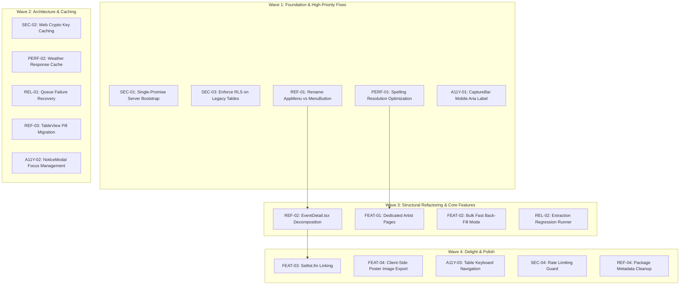

# LiveArchive Engineering Ticket Bank

> **Role & Purpose**: Authored by the Principal Engineering Lead. This document represents a comprehensive architectural audit, gap analysis, and ticket repository for future multi-threaded development on LiveArchive.  
> **Status**: Planning & Backlog. Ready for independent assignment across parallel engineering agents or contributors.
> **Guiding Documents**: [REQUIREMENTS.md](../REQUIREMENTS.md), [ARCHITECTURE.md](../ARCHITECTURE.md), and [AGENTS.md](../AGENTS.md).
> **Revised 2026-11-02**: SEC-01, PERF-01, PERF-02, REL-01, A11Y-02, A11Y-03 and FEAT-03 were rewritten after a code-checked peer review ([tier2-ticket-review.md](tier2-ticket-review.md)). FEAT-03 is blocked.

---

## Executive Summary & System Health

LiveArchive is an exceptionally well-architected, invariant-driven personal concert tracking application. It demonstrates strict discipline around data provenance (verbatim citations, no synthetic facts, separation of canonical editions from personal logs), offline capabilities, and cloud runtime cost constraints (free-tier Cloudflare Workers and Supabase).

However, as the system has expanded across 28 Supabase migrations and added multi-user capabilities, Cloudflare Access gating, email notifications, client-side encryption vaults, and timeline analytics, several architectural gaps, security hardening opportunities, component scaling bottlenecks, and UX polishes have emerged.

This backlog organizes **20 granular, self-contained engineering tickets** across 5 distinct tracks designed for concurrent multi-threaded execution.

---

## Ticket Overview Matrix

| ID | Track | Title | Priority | Complexity | Target Area |
|---|---|---|---|---|---|
| **SEC-01** | Hardening | Single-Promise Worker Server Bootstrap (cleanup, not a live bug) | P3 | Small | `worker/index.ts` |
| **SEC-02** | Security | Cache Web Crypto `CryptoKey` in Access Token Verification | P2 | Small | `src/server/share/access.ts` |
| **SEC-03** | Security | Enforce RLS on Legacy & Base Tables (`0002_source_first_lineups.sql`) | P1 | Medium | `supabase/migrations/` |
| **SEC-04** | Security | Add IP & Member Rate Limiting on Mutation Endpoints | P2 | Medium | `src/server/auth/`, `worker/` |
| **PERF-01** | Optimization | Scoped, Paged `listSeenArtistNames` for Spelling Resolution in `stageMerge` | P1 | Small | `src/server/lineup/pipeline.ts`, `store/*` |
| **PERF-02** | Optimization | Per-Host Cache Policy for the Open-Meteo Archive (deferrable) | P3 | Small | `src/server/lineup/responseCache.ts` |
| **PERF-03** | Optimization | Worker Subrequest Budgeting Guard in Stage 1 Research | P2 | Medium | `src/server/events/details.ts` |
| **REL-01** | Reliability | Per-Message Queue Error Handling & Dead-Letter Visibility | P2 | Small | `worker/index.ts`, `wrangler.jsonc` |
| **REL-02** | Reliability | Extraction Prompt & Model Regression Test Runner | P2 | Medium | `scripts/`, `src/server/lineup/` |
| **REF-01** | Refactoring | Resolve `MenuButton` Naming Collision with Shared Design System | P1 | Small | `src/components/`, `src/App.tsx` |
| **REF-02** | Refactoring | Decompose Monolithic `EventDetail.tsx` (1,552 LOC) | P2 | Large | `src/components/EventDetail.tsx` |
| **REF-03** | Refactoring | Migrate Inline Status Badges to Shared `Pill` Component | P2 | Small | `src/components/TableView.tsx` |
| **REF-04** | Refactoring | Align `package.json` Naming and Project Metadata | P3 | Trivial | `package.json` |
| **A11Y-01** | Accessibility | Fix Mobile Unlabelled Button in `CaptureBar` | P1 | Trivial | `src/components/CaptureBar.tsx` |
| **A11Y-02** | Accessibility | Standardize `NoticeModal` on Shared `Dialog` Focus Management | P2 | Small | `src/components/NoticeModal.tsx` |
| **A11Y-03** | Accessibility | Arrow-Key Row Navigation & Fewer Tab Stops in Table View | P2 | Medium | `src/components/TableView.tsx` |
| **FEAT-01** | Feature | Dedicated Artist Profile & Lifetime History View | P1 | Large | `src/components/`, `src/services/` |
| **FEAT-02** | Feature | Bulk Fast Back-Fill Mode (Multi-Line Batch Capture) | P2 | Medium | `src/components/`, `src/server/` |
| **FEAT-03** | Feature | Single-Artist Performance Setlist Linking (setlist.fm) — **blocked** | P2 | Medium | `src/server/events/`, `src/components/` |
| **FEAT-04** | Feature | Client-Side Shareable Poster & Year-in-Review Image Export | P2 | Medium | `src/components/`, `src/services/` |

---

## Track 1: Security & Defense-in-Depth

### [SEC-01] Single-Promise Worker Server Bootstrap
- **Classification**: Hardening / Cleanup (not a live bug; see [tier2-ticket-review.md](tier2-ticket-review.md#sec-01-cold-start-concurrency-race-in-ensureserver))
- **Priority**: P3 (Low)
- **Files**: [`worker/index.ts`](file:///Users/charliechonguyen/Projects/Concert-Tracker/worker/index.ts)
- **Problem**:
  The concurrent-`listen` race this ticket first described can't happen. `ensureServer` checks `listening` again after `await getDeps(env)`, and between that check and `listening = true` nothing yields (`createApiApp` and `app.listen` are synchronous). An isolate runs on one thread, so two cold requests can't both call `app.listen`.
  What is still loose:
  - `listening = true` is set even if `listen` later reports a failure through an asynchronous `'error'` event (for example `EADDRINUSE`). Every later request would then be sent to a port nothing is listening on.
  - The double-check idiom is easy to break in an edit. One `await` added between the second check and the assignment would bring the race back.
- **Implementation Strategy**:
  1. Replace `let listening = false` with `let serverPromise: Promise<void> | null = null`, the same pattern `getDeps` already uses.
  2. Build the app inside `serverPromise ??= (async () => { ... })().catch((err) => { serverPromise = null; throw err; })`.
  3. Wrap `listen` so it resolves on `'listening'` and rejects on `'error'`. A failed bind then resets `serverPromise`, and the next request tries again.
  4. Move the bootstrap into a small factory that takes `createApp` and `getDeps` as parameters, so it can be tested without workerd.
- **Invariants**: A failed startup is retried on the next request; `/api/health` still answers without starting the server; startup errors still return 503.
- **Test Plan**:
  - 5 `ensureServer` calls at once → `listen` called exactly once, and all 5 resolve.
  - First `getDeps` rejects → the second call retries and succeeds, and `listen` is called once.
  - `listen` emits `'error'` → the call rejects and the next call retries.

---

### [SEC-02] Cache Web Crypto `CryptoKey` in Access Token Verification
- **Classification**: Performance / Security Optimization
- **Priority**: P2 (Medium)
- **Files**: [`src/server/share/access.ts`](file:///Users/charliechonguyen/Projects/Concert-Tracker/src/server/share/access.ts)
- **Problem**:
  In `readAccessClaims`, JWK objects fetched from `${config.teamDomain}/cdn-cgi/access/certs` are cached in `keyCache`. However, on every single incoming authenticated request, `crypto.subtle.importKey('jwk', jwk, ...)` is called. Importing RSA public keys repeatedly consumes CPU cycles and creates garbage collection pressure in Cloudflare V8 isolates.
- **Implementation Strategy**:
  1. Expand the cached type to hold both the JWK and the imported `CryptoKey`:
     ```ts
     interface CachedKey {
       jwk: Jwk;
       cryptoKey?: CryptoKey;
     }
     ```
  2. Lazily import or eagerly import `CryptoKey` once upon caching JWKs.
  3. Reuse `cached.cryptoKey` directly in `crypto.subtle.verify`.
- **Invariants**: Cache TTL (1 hour) and forced refresh when unknown `kid` is encountered must remain identical.
- **Test Plan**: Run `tests/shareRoute.test.ts` and `tests/accessRequests.test.ts`; verify verification passes with zero regressions.

---

### [SEC-03] Enforce RLS on Legacy & Base Tables (`0002_source_first_lineups.sql`)
- **Classification**: Security Hardening / Database Hygiene
- **Priority**: P1 (High)
- **Files**: [`supabase/migrations/`](file:///Users/charliechonguyen/Projects/Concert-Tracker/supabase/migrations/)
- **Problem**:
  Tables defined in `0002_source_first_lineups.sql` (`canonical_artists`, `performances`, `source_documents`, `performer_claims`, `quota_ledger`, `source_stats`, `corrections`, `extraction_examples`, `attendance`, `seen_sets`) do not have `ALTER TABLE ... ENABLE ROW LEVEL SECURITY;`.
  Specifically, `attendance` and `seen_sets` are legacy tables from pre-0003 single-step flow that may still retain personal fields (`notes`, `companions`, `rating`, `ticket_price`) if an older installation was migrated.
- **Implementation Strategy**:
  1. Create migration `0029_enforce_rls_base_tables.sql`:
     - Enable RLS on all remaining shared/canonical tables: `canonical_artists`, `event_series`, `event_editions`, `performances`, `source_documents`, `performer_claims`, `quota_ledger`, `artist_aliases`, `extraction_blocklist`, `source_stats`, `corrections`, `extraction_examples`.
     - Add read-only policies for `authenticated` where needed (e.g. reading canonical lineups, editions), and restrict inserts/updates to `service_role`.
     - Explicitly drop or secure legacy tables `attendance` and `seen_sets`: verify if data was already migrated into `logged_events` (via 0003), drop tables if confirmed empty/legacy or lock with strict RLS.
- **Invariants**: Canonical editions are shared facts about the world; personal logs stay private. Service key continues full access.
- **Test Plan**: Execute `npm run test:rls` against scratch Postgres.

---

### [SEC-04] Add IP & Member Rate Limiting on Mutation Endpoints
- **Classification**: Security / Abuse Prevention
- **Priority**: P2 (Medium)
- **Files**: [`src/server/auth/gate.ts`](file:///Users/charliechonguyen/Projects/Concert-Tracker/src/server/auth/gate.ts), [`src/server/app.ts`](file:///Users/charliechonguyen/Projects/Concert-Tracker/src/server/app.ts)
- **Problem**:
  Gemini quota is meticulously tracked via `quota_ledger`, but unmetered API endpoints such as `POST /api/events` (bulk additions), `POST /api/access-requests`, and `POST /api/events/:id/details` (triggering external HTTP requests) have no per-IP or per-member rate limiter. An automated client could trigger upstream provider throttling or exhaust Workers CPU limits.
- **Implementation Strategy**:
  1. Add an in-memory sliding window or token bucket rate limiter in `src/server/auth/rateLimit.ts` for isolate-level protection (e.g. max 60 mutation requests per minute per member/IP).
  2. Return standard HTTP 429 with `Retry-After` header when threshold is breached.
- **Invariants**: Must not affect single-owner local dev; must not block background queue operations.
- **Test Plan**: Integration test sending bursts of requests; assert 429 response on burst exceedance.

---

## Track 2: Performance, Scalability & Reliability

### [PERF-01] Scoped, Paged `listSeenArtistNames` for Spelling Resolution in `stageMerge`
- **Classification**: Performance Optimization (revised after [tier2-ticket-review.md](tier2-ticket-review.md))
- **Priority**: P1 (High)
- **Files**: [`src/server/lineup/pipeline.ts`](file:///Users/charliechonguyen/Projects/Concert-Tracker/src/server/lineup/pipeline.ts), [`src/server/lineup/store/types.ts`](file:///Users/charliechonguyen/Projects/Concert-Tracker/src/server/lineup/store/types.ts), [`src/server/lineup/store/supabaseStore.ts`](file:///Users/charliechonguyen/Projects/Concert-Tracker/src/server/lineup/store/supabaseStore.ts), [`src/server/lineup/store/fileStore.ts`](file:///Users/charliechonguyen/Projects/Concert-Tracker/src/server/lineup/store/fileStore.ts)
- **Problem**:
  In `stageMerge` (line 369 of `pipeline.ts`):
  ```ts
  spellings: yourSpellings((await (job.userId && deps.store.forUser ? deps.store.forUser({ userId: job.userId, role: 'member' }) : deps.store).listEvents()).flatMap((e) => e.seen.map((a) => a.name)))
  ```
  `listEvents()` parses the member's whole event history (sources, details, weather, candidates) only to read `seen[].name`. It's one subrequest, but on Workers Free (10 ms CPU) the JSON parsing is the real cost. `listEvents` also doesn't page, so beyond PostgREST's default 1,000-row cap the list is cut short without any error.
- **Implementation Strategy**:
  1. Add `listSeenArtistNames(): Promise<string[]>` to `LineupStore` as a **required** method, so the compiler makes every store implement it.
  2. `SupabaseLineupStore`: `this.mine(this.own('logged_events').select('seen').is('deleted_at', null))`, paged with `.range(from, from + 999)` until a short page. Flatten to `seen[].name`. It must go through `mine()`/`own()` so `user_id` and RLS apply.
  3. `FileLineupStore`: flatten `seen[].name` over events that aren't deleted.
  4. **`scopedFileStore` overrides (required):** add `listSeenArtistNames: async () => (await keep('event', await base.listEvents())).flatMap(...)`. The scoped store is a `Proxy` that falls through to the base store for any method it doesn't override, so without this the method returns **every member's** names.
  5. `stageMerge` calls `scopedStore.listSeenArtistNames()`. Read only `seen[].name`, as today; don't add `b2b` names.
- **Invariants**: Only the names of the member who started the lookup; events in the trash are left out; spelling output is identical to today's.
- **Test Plan**:
  - Two members on the file store and on a mocked Supabase client → each scoped call returns only that member's names.
  - Deleted events are left out.
  - More than 1,000 rows on Supabase → the complete set comes back (paging works).
  - `stageMerge` candidate is unchanged on an existing `pipeline.test.ts` fixture.
- **Follow-up**: `listEvents` has the same 1,000-row gap (22 call sites). File a separate ticket.

---

### [PERF-02] Per-Host Cache Policy for the Open-Meteo Archive
- **Classification**: Performance / Caching (revised after [tier2-ticket-review.md](tier2-ticket-review.md); low value, can be deferred)
- **Priority**: P3 (Low)
- **Files**: [`src/server/lineup/responseCache.ts`](file:///Users/charliechonguyen/Projects/Concert-Tracker/src/server/lineup/responseCache.ts), [`src/server/lineup/service.ts`](file:///Users/charliechonguyen/Projects/Concert-Tracker/src/server/lineup/service.ts), [`ARCHITECTURE.md`](../ARCHITECTURE.md)
- **Problem**:
  `POST /api/events/:id/weather` always calls Open-Meteo. In practice weather is asked for once per event and stored on the event with its `sourceUrl`, so a repeat request means a refresh or a changed city. The hit rate will be low. Open-Meteo archive data is also **not** final: preliminary ERA5T values are replaced by final ERA5 values about 2–3 months later.
  The existing `cachingFetcher` can't take a second host as-is: it hard-codes `sourceType: 'ticketmaster'` and one global 24 h TTL, and it stores any status-200 body, including an archive answer that is all nulls.
- **Implementation Strategy**:
  1. Replace `CACHEABLE_HOSTS` with a per-host policy map: `{ sourceType, ttlMs, accept?(body): boolean }`. Ticketmaster keeps `{ 'ticketmaster', 24h }`.
  2. Add `'archive-api.open-meteo.com': { sourceType: 'open-meteo', ttlMs: 30 days, accept: daily.time non-empty and at least one non-null value }`.
  3. Keep the key as `cacheKey(url)`. It covers every parameter (`daily=`, `timezone`) and avoids float formatting. **Don't** add a hand-built `weather:${lat}:${lon}:...` key.
  4. **Never** cache the geocoder (`geocoding-api.open-meteo.com`). The "exactly one place" check has to run on live results.
  5. Update the comment in `responseCache.ts` on which hosts' terms allow caching, and update ARCHITECTURE.md. Caching stays behind `SOURCE_CACHE=on`.
- **Invariants**: Weather is looked up only when asked, only for a city that geocodes to exactly one place, and stored with its URL; a cache hit returns the same `sourceUrl`; Brave is still never cached.
- **Test Plan**:
  - A second identical archive request → 0 outbound calls, same `WeatherResult` including `sourceUrl`.
  - An all-null archive body is not stored.
  - Geocoder URLs always go to the network.
  - Ticketmaster entries keep a 24 h TTL with `sourceType: 'ticketmaster'`; Open-Meteo entries get 30 days with `sourceType: 'open-meteo'`.

---

### [PERF-03] Worker Subrequest Budgeting Guard in Stage 1 Research
- **Classification**: Reliability / Resource Management
- **Priority**: P2 (Medium)
- **Files**: [`src/server/events/details.ts`](file:///Users/charliechonguyen/Projects/Concert-Tracker/src/server/events/details.ts), [`src/server/events/service.ts`](file:///Users/charliechonguyen/Projects/Concert-Tracker/src/server/events/service.ts)
- **Problem**:
  On Cloudflare Workers Free plan, a request is restricted to 50 subrequests. During Stage 1 research (`researchEvent`), setlist.fm, Ticketmaster, Brave Search, and multiple web result pages are fetched. If an event has complex date queries or web search matches multiple pages, the execution can approach or exceed 50 subrequests, causing Worker runtime termination.
- **Implementation Strategy**:
  1. Introduce a subrequest counter abstraction passed into `researchEvent`.
  2. Enforce an upper bound (e.g. max 15 external fetches in Stage 1).
  3. Prioritize primary structured finders (Ticketmaster, setlist.fm) and cap secondary web page fetches.
- **Invariants**: Stage 1 must complete within a single request; empty/partial result is always valid.
- **Test Plan**: Run simulated Stage 1 research with mock finders asserting subrequest count <= 15.

---

### [REL-01] Per-Message Queue Error Handling & Dead-Letter Visibility
- **Classification**: Reliability / Observability (revised after [tier2-ticket-review.md](tier2-ticket-review.md))
- **Priority**: P2 (Medium)
- **Files**: [`worker/index.ts`](file:///Users/charliechonguyen/Projects/Concert-Tracker/worker/index.ts), [`wrangler.jsonc`](../wrangler.jsonc), [`ARCHITECTURE.md`](../ARCHITECTURE.md)
- **Problem**:
  `runJob` already catches every stage error: errors other than quota errors increment `attempts`, back off `2^n` minutes, and set `failed` after `MAX_ATTEMPTS = 3` (`pipeline.ts` 420–454). So the only errors that reach `queue()` are:
  1. `getDeps` failing (Supabase or config unreachable);
  2. `getJob`, the `updateJob` that sets `running`, or the final `updateJob` failing;
  3. `LOOKUP_QUEUE.send` failing after a stage finished;
  4. errors no catch block can see (CPU or wall-clock limit, isolate eviction).
  In cases 1–2 the store is down, so writing `status: 'failed'` would fail too. Marking `failed` on the first error would also throw away `runJob`'s backoff and make a temporary outage permanent. Case 4 can only be recovered by the stale-run reaper, by design. Cloudflare's retries (`max_retries: 3`) are already harmless: `runJob` sees `running` (not yet stale) and does nothing. The real gaps are that a whole batch is retried together and that failures after the retries vanish without a trace.
- **Implementation Strategy**:
  1. Wrap each message in try/catch. On error, log `jobId` and `redactSecrets(message)`, then call `message.retry({ delaySeconds: 60 })`. **Don't** `ack()` and **don't** write `failed`.
  2. Leave the success path as it is (`send` the next stage, then `ack()`).
  3. Add a `dead_letter_queue` to the consumer in `wrangler.jsonc`. Give it no consumer, or one that only logs, so there's never a second path that runs a job.
  4. Keep the stale-run reaper (`STALE_RUN_MS`) as the authority on stuck `running` rows. Document in ARCHITECTURE.md why it's longer than one stage's realistic run time.
- **Invariants**: A job's status changes only inside `runJob`; quota errors still park the job (no retry with another model); one stage per invocation; `max_concurrency: 1` is unchanged.
- **Test Plan**:
  - `getJob` throws → `message.retry` called, not `ack`, and the job row is unchanged.
  - The `send` after a stage throws → the job is left `queued` and `dueJobs` picks it up on the next cron.
  - A stage throws → `attempts` goes up, `nextAttemptAt` is set, and the job is **not** `failed` on the first error.

---

### [REL-02] Extraction Prompt & Model Regression Test Runner
- **Classification**: Developer Tooling / Quality Assurance
- **Priority**: P2 (Medium)
- **Files**: [`scripts/regression-extract.ts`](file:///Users/charliechonguyen/Projects/Concert-Tracker/scripts/), [`ARCHITECTURE.md`](file:///Users/charliechonguyen/Projects/Concert-Tracker/ARCHITECTURE.md)
- **Problem**:
  ARCHITECTURE.md Roadmap specifies: *"A regression command that re-runs extraction over stored documents and compares against confirmed lineups when the model or prompt changes."*
  Currently, changing `EXTRACTION_PROMPT_VERSION` or upgrading Gemini model versions requires manual testing without a regression benchmark over historical `source_documents`.
- **Implementation Strategy**:
  1. Create `scripts/regression-extract.ts` runnable via `npm run test:regression`.
  2. Load historical editions from DB/fixtures that have confirmed lineups and stored `source_documents`.
  3. Re-run Gemini extraction on dry-run mode against those stored HTML/text documents.
  4. Compare extracted names against the confirmed lineup; calculate recall, precision, and flag any hallucinated/unquoted names (`isVerbatim`).
  5. Print a regression summary report.
- **Invariants**: Deterministic evaluation; no production data modified.
- **Test Plan**: Execute dry run on test fixtures; verify report accurately computes match metrics.

---

## Track 3: Code Architecture & Modular Refactoring

### [REF-01] Resolve `MenuButton` Naming Collision with Shared Design System
- **Classification**: Refactor / Design System
- **Priority**: P1 (High)
- **Files**: [`src/components/MenuButton.tsx`](file:///Users/charliechonguyen/Projects/Concert-Tracker/src/components/MenuButton.tsx), [`src/components/ui/MenuButton.tsx`](file:///Users/charliechonguyen/Projects/Concert-Tracker/src/components/ui/MenuButton.tsx), [`src/App.tsx`](file:///Users/charliechonguyen/Projects/Concert-Tracker/src/App.tsx)
- **Problem**:
  There are two conflicting `MenuButton.tsx` files in the codebase:
  1. `src/components/MenuButton.tsx`: The application header menu (Theme, Import/Export, Sheets, Share, Members, Logout).
  2. `src/components/ui/MenuButton.tsx`: The generic design-system dropdown selector component (`<MenuButton<T> ... />`).
  In `src/App.tsx`, `import { MenuButton } from './components/MenuButton'` imports the app header menu. This creates naming collisions, breaks IDE auto-imports, and violates the rule that shared UI components live in `src/components/ui/`.
- **Implementation Strategy**:
  1. Rename `src/components/MenuButton.tsx` to `src/components/AppHeaderMenu.tsx` (exporting `AppHeaderMenu`).
  2. Update `src/App.tsx` and all call sites to import `AppHeaderMenu`.
  3. Ensure `src/components/ui/MenuButton.tsx` remains the authoritative generic dropdown component.
- **Invariants**: Visual look and mobile bottom-sheet behavior must remain 100% identical.
- **Test Plan**: `npm run lint` and `npm test` pass; verify header dropdown opens properly on desktop and mobile.

---

### [REF-02] Decompose Monolithic `EventDetail.tsx` (1,552 LOC)
- **Classification**: Refactor / Maintainability
- **Priority**: P2 (Medium/Large)
- **Files**: [`src/components/EventDetail.tsx`](file:///Users/charliechonguyen/Projects/Concert-Tracker/src/components/EventDetail.tsx), `src/components/event-detail/*`
- **Problem**:
  `EventDetail.tsx` has grown to 1,552 lines of code. It bundles together:
  - Form field debouncing and flashing (`Field`)
  - Autocomplete chip inputs (`ChipInput`)
  - Days attended logic (`DaysWent`)
  - Notes encryption and vault interaction (`NotesField`)
  - Lineup review, billing roles, and performer listing
  - Weather presentation, set times, and rating stars
  This makes regression testing difficult and hinders concurrent development.
- **Implementation Strategy**:
  1. Create directory `src/components/event-detail/`.
  2. Extract distinct subcomponents:
     - `NotesCard.tsx`: Encrypted notes field, lock/unlock indicators.
     - `WhenWhereCard.tsx`: Dates, days attended, venue, city, region, weather badge.
     - `WhoYouSawCard.tsx`: Seen acts, artist vs supporting, favourite set, B2B pairings.
     - `CompanionsField.tsx`: People chips, vault encrypted person references.
     - `EventDetailHeader.tsx`: Poster header, rating stars, series tag.
  3. Keep `EventDetail.tsx` as a lean coordinator component (~250 LOC).
- **Invariants**: Maintain save debounce timings (`SAVE_DELAY_MS = 500`), blur-save semantics for iOS Safari, and all existing test coverage.
- **Test Plan**: Manual verification of editing all fields; pass all existing detail tests.

---

### [REF-03] Migrate Inline Status Badges to Shared `Pill` Component
- **Classification**: Refactor / Design System
- **Priority**: P2 (Medium)
- **Files**: [`src/components/TableView.tsx`](file:///Users/charliechonguyen/Projects/Concert-Tracker/src/components/TableView.tsx), [`src/components/ui/Pill.tsx`](file:///Users/charliechonguyen/Projects/Concert-Tracker/src/components/ui/Pill.tsx)
- **Problem**:
  `TableView.tsx` contains multiple inline `<span className="inline-flex items-center gap-1 rounded-full border px-2 py-0.5 ...">` implementations for attendance status, kind (Concert/Festival), and series tags. AGENTS.md explicitly mandates: *"The design-system approach is wanted: when you touch a component that has its own inline copy of one of these patterns... move it onto the shared component in the same change."*
- **Implementation Strategy**:
  1. Inspect `src/components/ui/Pill.tsx`.
  2. Replace inline badge spans in `TableView.tsx` with `<Pill tone="neutral"|"accent"|"good"|"warn"|"info"|"highlight">`.
  3. Ensure series chips, attendance tags (Upcoming, Missed), and type chips render through `Pill`.
- **Invariants**: Good and warn states must always carry text (never rely on color alone).
- **Test Plan**: Visual inspection across light and dark themes; `npm run lint`.

---

### [REF-04] Align `package.json` Naming and Project Metadata
- **Classification**: Project Hygiene
- **Priority**: P3 (Low)
- **Files**: [`package.json`](file:///Users/charliechonguyen/Projects/Concert-Tracker/package.json)
- **Problem**:
  `package.json` still has `"name": "react-example"` from the initial template scaffolding.
- **Implementation Strategy**:
  1. Update `package.json` `"name"` to `"livearchive"`.
  2. Add description `"Personal concert tracking and lineup archive"`.
- **Invariants**: No dependency version changes.
- **Test Plan**: `npm run build` and `npm test` execute cleanly.

---

## Track 4: Accessibility (a11y) & UX Polish

### [A11Y-01] Fix Mobile Unlabelled Button in `CaptureBar`
- **Classification**: Accessibility (a11y)
- **Priority**: P1 (High)
- **Files**: [`src/components/CaptureBar.tsx`](file:///Users/charliechonguyen/Projects/Concert-Tracker/src/components/CaptureBar.tsx)
- **Problem**:
  In `CaptureBar.tsx`:
  ```tsx
  <button type="submit" disabled={!text.trim() || saving} className="...">
    {saving ? <Loader2 className="h-4 w-4 animate-spin" /> : <Plus className="h-4 w-4" />}
    <span className="hidden sm:inline">Add</span>
  </button>
  ```
  On mobile screens (`< 640px`), `<span className="hidden sm:inline">Add</span>` is hidden with `display: none`. The button lacks an `aria-label`, so screen reader users hear only "button" or an unlabelled SVG control.
- **Implementation Strategy**:
  1. Add `aria-label="Add event"` to the button.
  2. Add `aria-hidden="true"` to `<Plus>` and `<Loader2>` icons.
  3. Add `aria-live="polite"` to error and parsing preview regions.
- **Invariants**: No visual disruption to desktop layout.
- **Test Plan**: Screen reader audit or axe-core testing on mobile viewport.

---

### [A11Y-02] Standardize `NoticeModal` on Shared `Dialog` Focus Management
- **Classification**: Accessibility (a11y)
- **Priority**: P2 (Medium)
- **Files**: [`src/components/NoticeModal.tsx`](file:///Users/charliechonguyen/Projects/Concert-Tracker/src/components/NoticeModal.tsx), [`src/components/ui/Dialog.tsx`](file:///Users/charliechonguyen/Projects/Concert-Tracker/src/components/ui/Dialog.tsx)
- **Problem**:
  `NoticeModal.tsx` currently renders an ad-hoc backdrop and container (`<div className="fixed inset-0 z-[100] ...">`) without focus trapping, initial focus placement, or background scroll locking. In contrast, `src/components/ui/Dialog.tsx` implements strict focus containment, Tab cycling, Escape handling, and scroll locking.
- **Implementation Strategy**:
  1. Refactor `NoticeModal` to use `Dialog` with `placement="center"`.
  2. Add `dismissible?: boolean` to `Dialog` (default `true`), typed as a discriminated union so `dismissible: true` requires `onClose`. When it's `false`, Escape is ignored (`preventDefault`) and a backdrop `onMouseDown` does nothing.
  3. **Required:** make the app tree `inert` while the notice is open (`App.tsx` renders it alongside the app). Otherwise a dialog opened underneath, for example by a deep link, goes on top of `openDialogs` and takes Escape and Tab.
  4. **Required:** keep the notice above everything else. It uses `z-[100]` and `Dialog` uses `z-50`, so add a layer or z-index option. Pass a `panelClassName` that keeps `max-h-[90vh] overflow-y-auto`, so the accept button stays reachable on mobile.
  5. **Required:** while the request runs, use `aria-disabled` plus a guard instead of `disabled`, so focus doesn't fall to `<body>`. Give the error `role="alert"`.
- **Invariants**: Notice modal cannot be dismissed by clicking outside or pressing Escape (acceptance required). Existing dismissible dialogs behave exactly as before.
- **Test Plan**: Tab stays inside the modal; Escape and backdrop clicks don't close it; body scroll is locked and restored; focus stays inside after a failed accept; regression test that existing dialogs still close on Escape.

---

### [A11Y-03] Arrow-Key Row Navigation & Fewer Tab Stops in Table View
- **Classification**: Accessibility & Power UX (revised after [tier2-ticket-review.md](tier2-ticket-review.md))
- **Priority**: P2 (Medium)
- **Files**: [`src/components/TableView.tsx`](file:///Users/charliechonguyen/Projects/Concert-Tracker/src/components/TableView.tsx)
- **Problem**:
  Desktop rows already have `tabIndex={0}` and open on Enter (`TableView.tsx` ~622). What's missing: every row is its own tab stop, inner controls (such as the series button in `DetailsCell`) add more, and there's no arrow-key movement. With 100+ events, the table costs hundreds of Tab presses to get past.
- **Implementation Strategy**:
  1. Write a pure `nextRowId(rowIds, currentId, key)` helper (ArrowUp, ArrowDown, Home, End; clamps at both ends) so it can be unit-tested.
  2. Track the active row by **`event.id`**, not by index. When it's filtered out, fall back to the nearest remaining row, so some row always has `tabIndex=0`.
  3. Roving tabindex: the active row gets `tabIndex=0` and the others `-1`. Inner controls in rows that aren't active get `tabIndex=-1`.
  4. One `onKeyDown` on `<tbody>`, acting only when `e.target` is a row, so keys on inner buttons and in the filter or capture inputs pass through. Never listen on `document`. Call `preventDefault` on handled keys so the `overflow-auto` container doesn't scroll as well.
  5. Move by index into `rows`, never through DOM siblings, so today-indicator rows are skipped.
  6. Give rows `scroll-margin-top` (sticky `thead`) and call `scrollIntoView({ block: 'nearest' })`.
  7. Don't add `role="grid"`; keep native table semantics. The mobile `<ul>` (`md:hidden`) is unchanged.
- **Invariants**: Enter opens the row (unchanged); typing in the search input never moves row focus.
- **Test Plan**: `nextRowId` clamps and skips nothing; exactly one row has `tabIndex=0` at any time; after re-sorting, focus stays on the same event; Enter on an inner button doesn't open the row; key presses in the search input are ignored.

---

## Track 5: Strategic Feature Enhancements (Delight Roadmap)

### [FEAT-01] Dedicated Artist Profile & Lifetime History View
- **Classification**: Feature (Roadmap Delight #1)
- **Priority**: P1 (High)
- **Files**: `src/components/artist-profile/*`, [`src/components/ArtistsView.tsx`](file:///Users/charliechonguyen/Projects/Concert-Tracker/src/components/ArtistsView.tsx), [`src/services/artists.ts`](file:///Users/charliechonguyen/Projects/Concert-Tracker/src/services/artists.ts)
- **Spec Reference**: REQUIREMENTS.md Section 13 #1: *"Artist pages: every time you saw someone, with the venues and who you were with."*
- **Problem**:
  Currently, `ArtistsView.tsx` shows an aggregate list with expandable 3-event previews. There is no comprehensive artist profile that presents a user's full journey with an artist: first show, most recent show, all venues visited, companion breakdown, set types (DJ vs Live vs B2B), and personal ratings.
- **Implementation Strategy**:
  1. Add dedicated view state: `?view=artist&name=<artistKey>` in navigation service.
  2. Create `ArtistProfileView.tsx`:
     - Lifetime stats: Total times seen, solo vs support vs headliner, first seen date/venue, longest gap between shows.
     - Who you were with: Companions ranked by frequency with this artist.
     - Chronological timeline of every performance seen.
     - Genre and MusicBrainz metadata tags.
  3. Support one-tap navigation from Table view, Event detail chips, and Stats into this artist page.
- **Invariants**: Missing fields stay missing; names normalized via `normalizeName`.
- **Test Plan**: Verify artist profile accurately calculates lifetime stats across concerts and festivals.

---

### [FEAT-02] Bulk Fast Back-Fill Mode (Multi-Line Batch Capture)
- **Classification**: Feature (Roadmap Delight #2)
- **Priority**: P2 (Medium)
- **Files**: `src/components/BackfillModal.tsx`, [`src/server/events/routes.ts`](file:///Users/charliechonguyen/Projects/Concert-Tracker/src/server/events/routes.ts)
- **Spec Reference**: REQUIREMENTS.md Section 13 #2: *"Back-fill mode: type one line per event in a box (a whole year at once) and stage 1 handles each."*
- **Problem**:
  Adding past years of concert history one by one via `CaptureBar` requires repetitive typing and clicking. Users migrating from notes or personal logs want to paste 10-50 lines at once.
- **Implementation Strategy**:
  1. Add `POST /api/events/batch` accepting `{ lines: string[] }` (max 50 per request).
  2. Parse each line deterministically in code via `parseEventInput` (`src/server/events/parse.ts`).
  3. Store all created events in single batch `putEvents`.
  4. Create `BackfillModal.tsx` in UI with a multiline textarea, live preview table showing parsed dates/venues, and single "Save all" action.
- **Invariants**: Capture remains single-line format; no model call in parsing; Stage 2 lineup lookup is never triggered automatically.
- **Test Plan**: Unit test parsing 20 lines; integration test asserting batch creation in DB.

---

### [FEAT-03] Single-Artist Performance Setlist Linking (setlist.fm)
- **Classification**: Feature (Roadmap Delight #3)
- **Priority**: P2 (Medium)
- **Files**: [`src/server/events/details.ts`](file:///Users/charliechonguyen/Projects/Concert-Tracker/src/server/events/details.ts), [`src/components/EventDetail.tsx`](file:///Users/charliechonguyen/Projects/Concert-Tracker/src/components/EventDetail.tsx)
- **Spec Reference**: REQUIREMENTS.md Section 13 #3: *"Setlists: for a seen act at a single-artist show, link the setlist.fm setlist for that night."*
- **Status**: **BLOCKED** (see [tier2-ticket-review.md](tier2-ticket-review.md)). Unblock by: (a) updating REQUIREMENTS.md and ARCHITECTURE.md to move this from an idea to a requirement; (b) removing the made-up fallback URLs, `s.url ?? 'https://www.setlist.fm'` in `details.ts` and `s.url ?? doc.url` (a search URL) in `adapters/setlistfm.ts`, so neither can ever be stored as a setlist link.
- **Required constraints once unblocked**:
  - Accept only an API-provided URL matching `^https://www\.setlist\.fm/setlist/[^/]+/\d{4}/.+\.html$`; otherwise store nothing.
  - Attach a link only when the setlist's `eventDate` equals the event's stored `startDate` exactly (the finder's ±1 day window is not enough), the venue matches, there's exactly one setlist for that artist that day, the artist's normalized name equals one seen act, and the event's scale is Concert (`scale.ts`). Only from the candidate that was applied or picked.
  - Store it separately from `SeenAct` (for example `event.setlists: Array<{ actKey, url, eventDate, venue, checkedAt }>`), joined by `key` when rendering, so renaming or removing an act can't leave a stale or misattached link.
  - Decide explicitly whether the link appears on public share pages.
  - Tests: missing `s.url` → no link; ±1 day match → no link; two same-day setlists → no link; renamed act → link dropped; never set from a Gemini-read source.
- **Problem**:
  When setlist.fm matches an event in Stage 1 research, the setlist URL is used internally for date/venue confirmation but is not stored or surfaced as a persistent setlist citation link on the seen artist row.
- **Implementation Strategy**:
  1. When setlist.fm finder confirms an event, capture the `setlist.fm/setlist/...` URL in candidate metadata.
  2. Store setlist URL under `LoggedEvent.sources` or `SeenAct.setlistUrl`.
  3. On the Event Detail view, render a discrete external link "Setlist on setlist.fm" next to the seen artist.
- **Invariants**: Only link if confirmed for that exact date and artist; never fabricate setlists.
- **Test Plan**: Test verifying setlist URL is preserved and rendered only when matched.

---

### [FEAT-04] Client-Side Shareable Poster & Year-in-Review Image Export
- **Classification**: Feature (Roadmap Delight #4)
- **Priority**: P2 (Medium)
- **Files**: `src/services/posterExport.ts`, `src/components/SharePosterModal.tsx`
- **Spec Reference**: REQUIREMENTS.md Section 13 #4: *"Share card: an image of one event or one year, generated from your own data."*
- **Problem**:
  Users want to share a visual summary of an event or a festival year on social media or with friends without sharing an interactive web link.
- **Implementation Strategy**:
  1. Create a pure client-side SVG/Canvas generator (`src/services/posterExport.ts`).
  2. Render an elegant festival-style poster or typography card:
     - Event title, year, venue, city.
     - Billed artist names grouped by headliner and support.
     - Optional personal badge (favourite set, rating stars).
  3. Provide "Copy Image" (Clipboard API) and "Download PNG" actions.
- **Invariants**: 100% client-side; no server-side rendering or image storage; privacy fields (notes, companions) excluded.
- **Test Plan**: Generate PNG for test event; verify output dimensions and crisp rendering on retina displays.

---

## Multi-Threaded Development Plan & Dependencies

To execute these tickets across parallel worker agents or contributors without merge conflicts:



### Guidance for Workers
1. **Rule of 3 Areas**: If a ticket spans more than 3 architectural areas, present the design breakdown and obtain confirmation before modifying code.
2. **Quality Gate**: Every ticket must pass `npm run lint` and `npm test` before completion.
3. **Docs Integrity**: Update [ARCHITECTURE.md](../ARCHITECTURE.md) and [REQUIREMENTS.md](../REQUIREMENTS.md) in the same pull request if behavior or schemas change.
