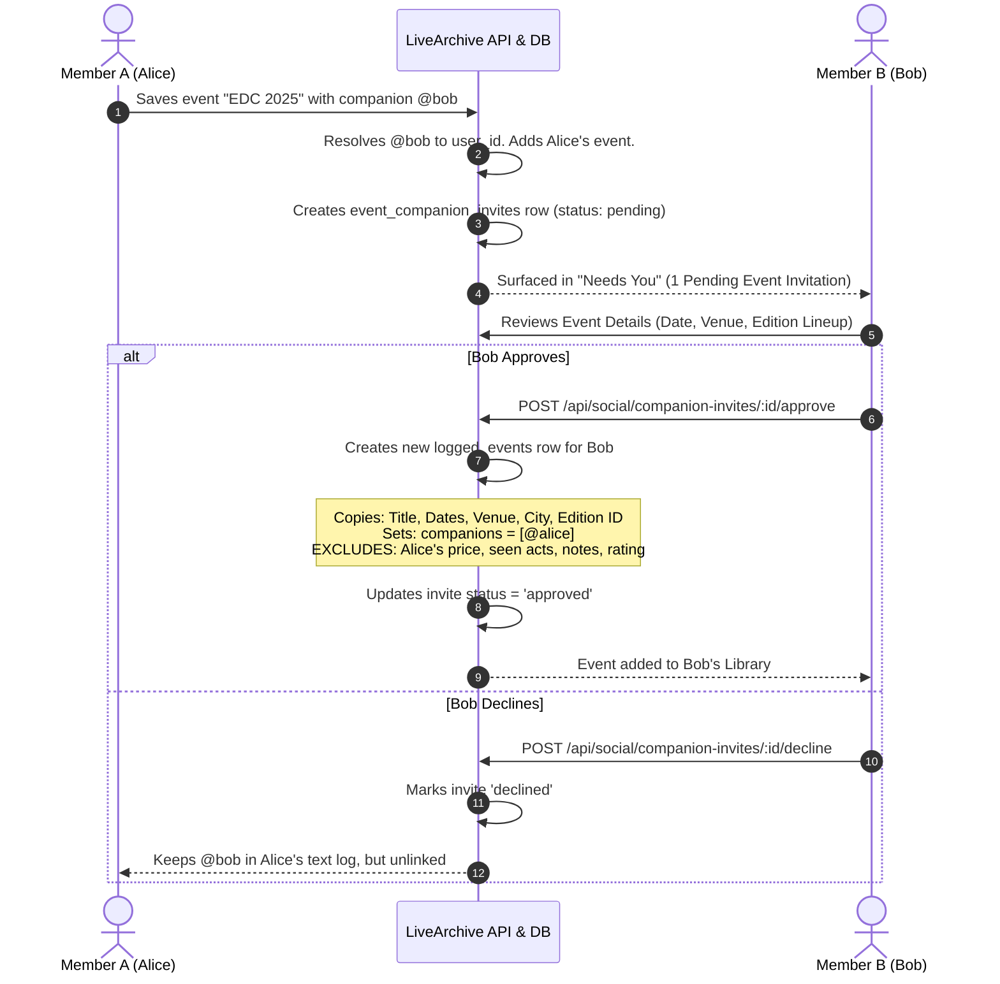

# LiveArchive Social Features Specification & Architectural RFC

**Status:** Not started. A discussion draft only.  
**Date:** November 2026  
**Document Owner:** Antigravity / Product & Engineering  
**Target Audience:** Core Contributors, Architecture Reviewers, Claude  

---

## 1. Executive Summary & Philosophical Alignment

LiveArchive was founded on an uncompromising principle: **LiveArchive helps one person remember which events they went to and who they saw there. Everything else is secondary.** Historically, `REQUIREMENTS.md` explicitly stated *"No social features"* to protect user privacy, prevent feature bloat, and avoid turning a trusted personal archive into an algorithmic dopamine trap.

However, live music and festivals are fundamentally shared, communal experiences. Attending a show is rarely done in isolation; people attend with friends, split costs, compare who saw which act across festival stages, and plan upcoming concert calendars together.

This document outlines a proposal for a **High-Trust, Sovereignty-Preserving Social Layer**. Rather than introducing public social feeds, likes, or follower counts, this specification explores a **peer-to-peer, consent-first collaborative memory system**.

### The Core Paradigm: Social as an Amplifier of Personal Memory
1. **Consent-First:** No one can link to you, tag you, or see your history without explicit bilateral consent.
2. **Zero Involuntary Ingestion:** A friend adding you to an event *proposes* an entry; it never appears in your log without your affirmative review and acceptance.
3. **Strict Data Boundary:** Shared events copy only objective facts of the world (venue, date, canonical lineup). Subjective personal fields (who you saw, ticket price, notes, ratings) never bleed between accounts.
4. **Sovereignty & Incognito:** Any event can be designated as private/incognito, hiding it from all social graphs and group aggregates.
5. **Decoupled Lifecycle:** Disconnecting, unfollowing, blocking, or account deletion must never corrupt or delete historical memories from a friend's log.
6. **Vault Compatibility:** Social features must respect or cleanly negotiate with LiveArchive's client-side AES-GCM encrypted private vault.

---

## 2. Requirements Matrix

### 2.1 Must-Have Requirements (Core Contract)

* **M1: Peer-to-Peer Following & Mutual Consent Linking:** Members can discover and connect via three identifiers:
  * Verified email lookup (for existing friends).
  * Unique, user-chosen handle/username (new namespace).
  * Cryptographic, revocable shareable invite link (`/join/<code>` or `/u/<username>?invite=...`).
* **M2: Follower & Following Directory:** A clean interface allowing users to review who they follow, who follows them, pending link requests, and incoming/outgoing connection requests.
* **M3: "I Went With" Entity Resolution:** When logging or editing an event, the "Companions / Went With" input allows linking directly to followed members in addition to plain-text/custom person entities.
* **M4: Co-Attribution Review Flow (The Involuntary Ingestion Guardrail):**
  * If User A logs an event and adds User B to "I went with", User B receives a pending invitation notification in their "Needs You" inbox.
  * User B must explicitly **Approve** or **Decline**.
  * **On Approval:** A linked event is created in User B's log. Common details (event name, date, venue, city, edition/lineup reference, and the mutual companion link) are populated.
  * **Strict Data Quarantine:** User A's personal details (`price`, `seen` acts, `rating`, `notes`, personal tags, other private companions) are **never** copied to User B.
* **M5: Breakup / Unlink Lifecycle Protocol & Sovereignty Preservation:**
  * If User A and User B unfollow, disconnect, or block each other:
    * **Preserve Historical Integrity:** User B's historical event log is **not** deleted or modified. The show happened; attending it remains an immutable fact of personal memory.
    * **Graceful Degradation:** The active companion hyperlink (`@userB`) on User A's past event cleanly degrades into a static, decoupled text snapshot (`User B`) or an anonymized entity without breaking the layout.
    * **Immediate Metric Scrubbing on Block:** Setting a block severs all active connections, immediately scrubs the blocked member from mutual stats, group counts, and overlap tallies, and hides the blocker from search/lookup.
    * **Account Deletion:** If a user deletes their account, foreign key cascades sever connection links while past companion strings on friends' logged events revert to static historic names.
* **M6: Master "Single-Player" Stealth Toggle:**
  * A user can turn off social features entirely in Account Settings (`Social Features: Off`).
  * When disabled, all social tabs, follower lists, companion suggestion popovers, friend badges, and profile endpoints disappear from the UI. The application behaves 100% as a single-player personal archive.

---

### 2.2 Exploratory & Nice-to-Have Ideas (Vetting & Scope Evaluation)

*These features represent high-value opportunities that could significantly elevate LiveArchive, but must be deeply vetted and tested to prevent scope creep or bloat.*

#### Privacy & Permissions
* **E7: Granular Sharing Tiers:** Multi-tiered privacy controls for what followed friends can see:
  * *Tier 0 (Stealth / Unlinked):* Mutual companion tagging enabled, but no profile or timeline visibility.
  * *Tier 1 (High-Level Stats):* High-level summary visible (total shows, top 5 seen artists, active years, venues visited).
  * *Tier 2 (Full History / Timeline):* Full chronological event list visible, but sensitive fields (notes, ratings, prices, companions) remain strictly masked.
* **E8: Event-Level "Incognito" / Private Mode:**
  * A per-event toggle (`is_private` / `incognito`) that excludes an event from all public profiles, social feeds, group stats, and friend-overlap queries (essential for private events, circuit parties, secret shows).
* **E9: Companion Graph Transitivity ("Went With" Network):**
  * *Scenario:* Charlie goes with Justin, and Justin goes with Sam. Does Charlie see Sam?
  * Need to evaluate privacy risks and UI complexity of first-degree vs second-degree visibility.

#### Profiles & Management
* **E10: Public / Social Profile Pages:** A public or authenticated profile page (`/u/<username>`) displaying approved stats/events and a direct "Connect / Follow" button.
* **E11: Social Connections Management Hub:** A dedicated settings panel to audit active connections, revoke access, manage default sharing tiers, and ban/block accounts.
* **E12: Friend Groups / Audience Circles:**
  * Segmenting followed friends into circles (e.g. *"Rave Fam"*, *"Local Indie Crew"*, *"Close Friends"*).
  * Allows scoping visibility and group metrics to specific sub-audiences.

#### Onboarding & Nostalgia
* **E13: Day-1 Retroactive Backfill Wizard:**
  * *The Problem:* When two long-time concert friends connect on Day 1, they may already have 20 shared past shows in their logs. Manually tagging and approving 20 individual shows is tedious.
  * *The Solution:* A mutual scan upon connecting that identifies identical past events (same date, venue, edition) and offers a one-tap batch confirmation: *"You both logged 8 identical events. Link each other as companions on all 8?"*
* **E14: Post-Event Debrief & Overlap Summary:**
  * After a shared multi-stage festival or show: *"You and Justin both attended Portola 2024. You caught 9 of the same sets and split up for 4."*
* **E15: Mutual Shared Milestones:**
  * Celebrating shared history: *"10th show attended together with Justin!"*, *"First show together: Porter Robinson, 2018"*, *"Most frequent companion: Justin (18 shows)"*.

#### Festival Coordination & Real-World Logistics
* **E16: Festival Timetable / Side-by-Side Set Conflict Matrix ("Who Are You Seeing?"):**
  * At multi-stage festivals (EDC, Coachella, Glastonbury, Movement), friends constantly coordinate set conflicts.
  * A side-by-side timetable view for friends attending the same edition, highlighting set overlaps (where you'll be together) vs splits (where you diverge).
* **E17: "Interested In / Want to Go" Pre-Sale Pipeline & Friend Buzz:**
  * Capturing tour announcements and on-sale dates before tickets are purchased.
  * Personal wishlist tracking + non-intrusive friend buzz (*"3 friends want to go to Justice at the Armory"*).
* **E18: Spare Ticket / Ticket Need Beacon:**
  * A lightweight, non-spammy beacon on an upcoming show: `[I have 1 extra ticket]` or `[Looking for a ticket]`.
  * Visible only to confirmed connections as a private coordination signal. Zero payment processing or marketplace fees.
* **E19: External Shared Photo/Video Album Links:**
  * Rather than storing heavy media in LiveArchive, allow attaching an external shared album URL (Google Photos, iCloud Shared Album, Dropbox) to an event. If friends are linked, both can tap to open the shared album.
* **E20: Collaborative Playlist Generation:**
  * One-tap export to Spotify / Apple Music of all artists seen together in a given year or at a specific festival.

---

## 3. Architecture & Data Model Proposals

### 3.1 Identity & Addressing Schema

Currently, LiveArchive authenticates exclusively through Cloudflare Access (`CF_Authorization` JWT linked to Google OAuth). Members exist in the `members` table keyed by `user_id` (UUID) and `email`.

To support social linking, we propose a new `user_profiles` schema:

```sql
CREATE TABLE user_profiles (
  user_id UUID PRIMARY KEY REFERENCES members(user_id) ON DELETE CASCADE,
  username TEXT UNIQUE NOT NULL,
  username_normalized TEXT UNIQUE NOT NULL, -- lowercase, alphanumeric + underscores
  display_name TEXT NOT NULL,
  bio TEXT,
  avatar_url TEXT,
  visibility_tier TEXT NOT NULL DEFAULT 'private', -- 'private', 'friends_stats', 'friends_full', 'public'
  social_enabled BOOLEAN NOT NULL DEFAULT true, -- Master switch (M6)
  allow_email_discovery BOOLEAN NOT NULL DEFAULT true,
  allow_companion_invites BOOLEAN NOT NULL DEFAULT true,
  created_at TIMESTAMPTZ NOT NULL DEFAULT now(),
  updated_at TIMESTAMPTZ NOT NULL DEFAULT now()
);

CREATE INDEX idx_user_profiles_username_norm ON user_profiles(username_normalized);
```

#### Username Guidelines & Edge Cases:
* **Format:** 3 to 24 characters, `^[a-zA-Z0-9_]+$`.
* **Immutability vs Changing:** Usernames can be changed once every 30 days, retaining a 14-day reservation on the previous handle to prevent impersonation.
* **Email Discovery Guard:** If `allow_email_discovery` is false, searching by email returns zero results to prevent email-scraping attacks.

---

### 3.2 Social Relationships & Lifecycle (`social_connections`)

Relationships must support asymmetrical following with mutual consent and clean decoupling:

```sql
CREATE TABLE social_connections (
  id UUID PRIMARY KEY DEFAULT gen_random_uuid(),
  requester_id UUID NOT NULL REFERENCES members(user_id) ON DELETE CASCADE,
  recipient_id UUID NOT NULL REFERENCES members(user_id) ON DELETE CASCADE,
  status TEXT NOT NULL CHECK (status IN ('pending', 'connected', 'declined', 'blocked')),
  sharing_tier TEXT NOT NULL DEFAULT 'mutual_default', -- custom overrides per friend
  circle TEXT DEFAULT 'default', -- optional friend circle (E12)
  created_at TIMESTAMPTZ NOT NULL DEFAULT now(),
  updated_at TIMESTAMPTZ NOT NULL DEFAULT now(),
  CONSTRAINT chk_different_users CHECK (requester_id <> recipient_id),
  CONSTRAINT uq_social_pair UNIQUE (requester_id, recipient_id)
);

CREATE INDEX idx_social_connections_recipient ON social_connections(recipient_id, status);
CREATE INDEX idx_social_connections_requester ON social_connections(requester_id, status);
```

#### Connection Lifecycle & Unlinking (M5 Implementation):
1. **Unfollowing / Disconnecting:** Transitions status to `unlinked`. Does not trigger any deletion of past shows in either user's log.
2. **Blocking:** Transitions status to `blocked`. Immediately severs all active connections, purges pending companion invitations, and scrubs the blocked user from mutual aggregate statistics.
3. **Ghost Prevention:** Queries computing companion names fall back:
   ```sql
   COALESCE(up.display_name, c.static_name_snapshot, 'Former Member')
   ```

---

### 3.3 Co-Attribution & Companion Invitations (`event_companion_invites`)

To satisfy **M4**, companion attributions are decoupled until mutual consent is achieved:

```sql
CREATE TABLE event_companion_invites (
  id UUID PRIMARY KEY DEFAULT gen_random_uuid(),
  sender_user_id UUID NOT NULL REFERENCES members(user_id) ON DELETE CASCADE,
  recipient_user_id UUID NOT NULL REFERENCES members(user_id) ON DELETE CASCADE,
  sender_event_id UUID NOT NULL REFERENCES logged_events(id) ON DELETE CASCADE,
  recipient_event_id UUID REFERENCES logged_events(id) ON DELETE SET NULL,
  status TEXT NOT NULL CHECK (status IN ('pending', 'approved', 'declined', 'unlinked')),
  created_at TIMESTAMPTZ NOT NULL DEFAULT now(),
  responded_at TIMESTAMPTZ,
  CONSTRAINT uq_event_companion UNIQUE (sender_event_id, recipient_user_id)
);
```

#### Event Ingestion & Synchronization Workflow:


---

## 4. Deep Technical & Architectural Challenges

### 4.1 The Vault Conflict (Client-Side AES-GCM Encryption)
LiveArchive provides an optional **Private Vault** where:
* `notes`, `companions`, and people's names are encrypted in the user's browser with an AES-GCM master key derived via PBKDF2.
* The server only stores ciphertext `v1:<iv>:<ciphertext>` and HMAC tokens.
* The server **cannot** read companion names.

**The Architectural Dilemma:**
* If Alice has her Vault enabled, her `companions` array contains encrypted tokens or client-side entities (`user_entities`).
* How does the server know to send a companion invite to Bob if Alice's client has encrypted Bob's identity before transmitting?

**Proposed Solution:**
* Separate **Private Personal Entity Records** from **Social Member Links**:
  * An event maintains `companions` (string names / private encrypted entity IDs for offline/vault people) AND `linked_member_ids` (an array of verified public member UUIDs).
  * The link to Bob's account UUID is stored as an unencrypted relational pointer (`linked_member_ids`), while any personal nickname or private notes Alice keeps about Bob stay in her local encrypted vault.
  * If a user requires 100% metadata anonymity (where even the existence of an association with Bob is confidential), the user leaves the companion unlinked as a local-only entity.

### 4.2 Row Level Security (RLS) & Multi-User Isolation
Currently, Supabase Postgres enforces strict single-tenant RLS:
```sql
CREATE POLICY own_rows ON logged_events
  FOR ALL TO authenticated
  USING (user_id = auth.uid())
  WITH CHECK (user_id = auth.uid());
```
Nobody can read any row belonging to another user.

**Required RLS Evolution:**
To allow friend viewing, group stats, and profile inspection without creating data leak vulnerabilities:
1. `logged_events` must remain strictly private to `auth.uid()`, OR
2. Introduce a dedicated view / RPC (`get_friend_events(target_user_id)`) that uses `SECURITY DEFINER` and enforces:
   * Target user has an active mutual `connected` status with caller.
   * Target user's `visibility_tier` permits timeline inspection.
   * `is_private = false` (Incognito events stripped).
   * Restricts selected columns to `SHARE_EVENT_COLUMNS` only (forcing omission of `price`, `rating`, `notes`, `companions`, `seen`).

---

## 5. Privacy, Security & Legal Threat Modeling

| Threat Vector | Risk Level | Description | Proposed Mitigation |
| :--- | :--- | :--- | :--- |
| **Physical Stalking / Real-Time Tracking** | **High** | A bad actor uses upcoming events or "interested in" statuses to track a victim's exact physical whereabouts. | 1. Upcoming events are hidden from friend profiles by default.<br/>2. No real-time check-ins.<br/>3. An event only appears on past-event views once its last calendar day has concluded.<br/>4. Require explicit, separate opt-in for sharing "Planned / Upcoming" shows. |
| **Unwanted Tagging & Harassment** | **Medium** | An abusive user repeatedly tags someone in events they never attended or sends spam requests. | 1. Only established connections (`status = 'connected'`) can issue companion invites.<br/>2. Blocking immediately prevents any future invites and deletes pending ones.<br/>3. Rate limits on connection requests per 24-hour window. |
| **Financial / Price Leakage** | **High** | Ticket prices or spending totals leak into friend views or group metrics. | Strict prohibition: `price` is quarantined. It is never included in social APIs, group aggregates, or shareable summaries. |
| **Sensitive Event Exposure** | **High** | A user attends a private gathering, circuit party, recovery group event, or confidential venue that they do not want family/coworkers to see. | Per-event `Incognito / Private` flag (E8). When set, the event behaves as if it does not exist for all social endpoints. |
| **Notification Fatigue & Social Pressure** | **Medium** | Users feel anxious about unread badges or pressure to approve companion invites. | **Zero push notifications for social actions.** All invites surface calmly in `Needs You` when the user opens the app on their own terms. |
| **GDPR / CCPA Right to Erasure** | **High** | User requests account deletion. What happens to companion tags on friends' past shows? | Cascade delete severs connection links. On friends' shows, the companion tag converts to an anonymized, unlinked text label (e.g. "Former Member" or the historic display name captured at the time) without retaining foreign keys. |

---

## 6. Open Questions for Claude & Core Team Discussion

Use these questions to drive the upcoming collaborative design session:

1. **Identifier Strategy:**
   * Should we introduce public `@usernames`, or would cryptographic invite links + verified Google email lookup be sufficient and more privacy-preserving for a close-friends app?
2. **Event Link Symmetry:**
   * When Bob accepts Alice's companion invitation, should Bob's event store a bidirectional pointer to Alice's event record, or should it simply reference the shared **canonical edition** (`editions` table) with a `companion_user_ids` array?
3. **The "Interested In / Buzz" Pre-Event Pipeline (E17):**
   * Should "Want to Go / Interested" be designed as a personal stage-0 feature first (e.g., capture an event before purchasing tickets), and only later surfaced to friends?
4. **Vault Interoperability:**
   * If a user has enabled the browser-encrypted Vault, how should the UI explain the difference between a private, encrypted companion name vs a verified social member link?
5. **Vetting the Scope of Exploratory Items:**
   * Which exploratory features (e.g. Festival Matrix vs Retroactive Backfill vs Ticket Beacon) deliver the highest user delight relative to architectural maintenance burden?

---

## 7. Staged Implementation Roadmap (Proposed)

* **Phase 1: Foundations & Sovereignty (Non-Social Core)**
  * Master Social Toggle (`social_enabled: false` by default or opt-in) (M6).
  * Per-event `Incognito / Private` toggle (E8).
  * Introduce `user_profiles` schema.
* **Phase 2: Direct Peer Connections (M1, M2, M5)**
  * Asymmetric request & mutual accept connection protocol.
  * Connect via invite link, username, or verified email.
  * Disconnect, Unlink, and Blocking lifecycle protocols.
* **Phase 3: Collaborative Co-Attribution (M3, M4)**
  * Companion autocomplete suggesting connected friends.
  * Companion invite flow in "Needs You" inbox.
  * Quarantine pipeline ensuring zero leakage of personal fields.
* **Phase 4: Exploratory Features (Deep Vetting & Gradual Rollout)**
  * Day-1 Retroactive Backfill Wizard (E13).
  * Side-by-side Festival Timetable Matrix (E16).
  * Granular visibility tiers & friend group circles (E7, E12).
